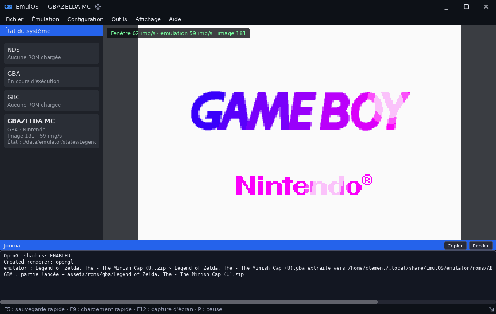
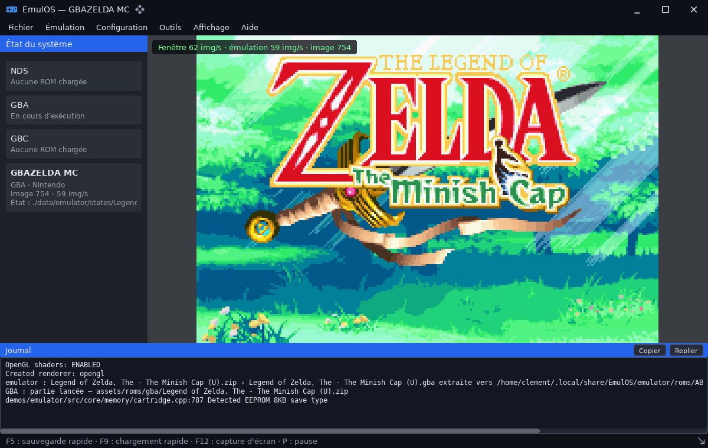
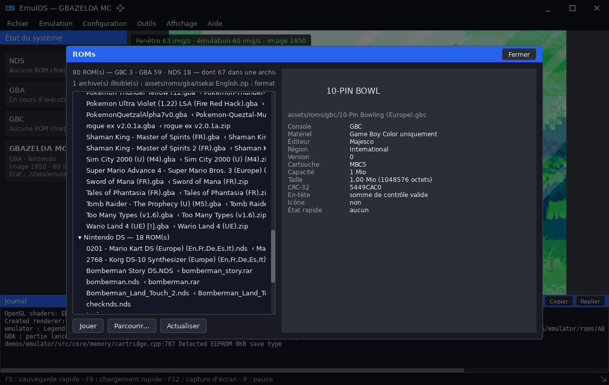
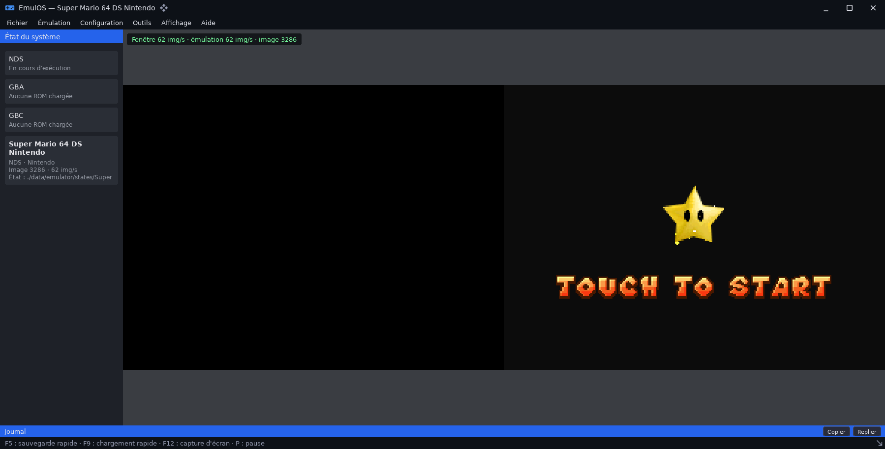

# emulator — émulateur Nintendo DS, Game Boy Advance et Game Boy Color

`demos/emulator` · exécutable `emulator` · espace de noms `emulator::`

## Présentation

`emulator` émule la **Nintendo DS**, la **Game Boy Advance** et la **Game
Boy / Game Boy Color**. Son cœur est dérivé de NooDS : processeurs ARM9 et
ARM7, rendu 2D et 3D, son, mémoire, cartouches et BIOS en HLE ; un cœur GBC
est fourni à part. Il est présenté dans une coquille graphique, « EmulOS »,
construite avec [`ui`](libs_infrastructure_ui.md) :

- menus et panneau d'état ;
- vue du jeu avec bandeau de performances ;
- journal ;
- boîtes de dialogue : ROMs, états sauvegardés, configuration, triches,
  réseau, à propos.

L'application montre l'utilisation du wrapper pour une application temps
réel : fil d'émulation, audio cadencé, manettes, glisser-déposer et
sélecteurs de fichiers natifs. Une ROM peut être lancée **directement depuis
une archive** (`.zip`, `.7z`, `.tar.gz`, `.gz`…, voir
[archive](libs_infrastructure_archive.md)).



| | |
|---|---|
|  |  |
|  | |

## Architecture

| Élément | Rôle |
|---|---|
| `src/main.cpp`, `src/emulator.cpp`, `include/emulator/emulator.hpp` | Ligne de commande, modes (aide, listes, sans écran, fenêtré), rapport d'exécution, code de sortie |
| `src/core/` (`cpu/`, `gpu/`, `gbc/`, `hle/`, `io/`, `memory/`, `core.cpp`, `save_states.cpp`, `settings.cpp`) | Cœur d'émulation et réglages (`config.ini`) |
| `src/app/emulator_session.cpp` | **Une partie** : cœur, fil d'émulation, entrées, états, dernière image. Ne connaît ni fenêtre ni renderer, ce qui permet le mode sans écran |
| `src/app/game_view.cpp` | Affichage seul : textures, letterbox, écran tactile |
| `src/app/application.cpp`, `modals.cpp` | Coquille « EmulOS » et boîtes de dialogue |
| `src/app/rom_source.cpp`, `rom_metadata.cpp` | Chargement depuis le disque ou une archive ; métadonnées (code produit, région, version, matériel, type de sauvegarde, sommes de contrôle) |

**Discipline des fils** :

- tout ce qui touche le cœur (boutons, réseau, sauvegardes demandées par
  l'interface) s'exécute **sur le fil d'émulation, entre deux images** ;
- seule la copie de l'image terminée passe sous verrou ;
- l'audio cadence le cœur : la pompe attend que la file redescende sous deux
  blocs.

Modules utilisés : `core`, `ecs`, `sdl3`, `ui`, `archive`. Le module est
compilé en **`-O2` même en mode debug**, car l'émulation est temps réel
(`cxxflags` du `module.toml`).

## Données

| Chemin | Rôle |
|---|---|
| `assets/bios-firmware/<console>/` | BIOS et firmware : `ndsBios9.bin`, `ndsBios7.bin`, `firmware.bin`, `gbaBios.bin`. Une ROM GBA a besoin de son BIOS, que le cœur n'émule pas en HLE |
| `assets/roms/` | ROMs listées par la boîte « ROMs » et par `--list-roms` (**non versionné** : `.gitignore` exclut `roms*/` et `*.bin`) |
| `data/emulator/config.ini` | Réglages |
| `data/emulator/states/` | États sauvegardés (sauvegarde rapide `<rom>.state0`) |
| Dossier de préférences SDL (`~/.local/share/EmulOS/emulator/roms`) | Cache des ROMs extraites d'archives ; les sauvegardes `.sav` restent à côté de l'archive |

## Utilisation

```sh
cpp-maker run -m emulator                                  # interface
cpp-maker run -m emulator -- assets/roms/gba/jeu.zip       # lancer une ROM
cpp-maker run -m emulator -- --help                        # toutes les options
```

Raccourcis :

| Touche | Action |
|---|---|
| F5 | Sauvegarde rapide |
| F9 | Chargement rapide |
| F12 | Capture d'écran |
| P | Pause |

### Options de la ligne de commande

Les numéros d'image désignent des **images émulées**. Un scénario se déroule
donc à l'identique avec ou sans fenêtre.

| Catégorie | Options |
|---|---|
| ROM et console | `--rom=CHEMIN` (ou argument positionnel), `--rom-entry=NOM`, `--extract-dir=DIR`, `--archive-password=MOT`, `--config=CHEMIN`, `--no-save-config`, `--bios-dir=DIR`, `--boot=direct|bios`, `--arm7-hle`, `--threaded-2d`, `--threaded-3d`, `--layout=horizontal|vertical`, `--state-dir=DIR`, `--state-path=CHEMIN`, `--save-dir=DIR` |
| Fenêtre | `--width=N`, `--height=N` (1200×760 par défaut), `--no-audio`, `--speed=normal|unlimited`, `--hide-hud`, `--open=roms|saves|config|cheats|network|about` |
| Pilotage | `--frames=N`, `--press=N:BOUTON[:DURÉE]` (répétable), `--save-state=N`, `--load-state=N` |
| Observation | `--report=CHEMIN`, `--report-format=text|json`, `--screenshot=N:CHEMIN`, `--screenshot-every=K`, `--screenshot-dir=DIR`, `--require-video`, `--verbose` |
| Modes | `--headless` (sans fenêtre, GPU ni audio), `--rom-info`, `--list-roms[=DIR]`, `--list-buttons`, `-h`/`--help` |

Exemples tirés de l'aide :

```sh
# Vérification sans écran : 20 s de jeu, START à 3 s, capture et rapport JSON
emulator --headless --rom=jeu.gba --frames=1200 --press=180:START --save-dir=/tmp/data \
    --screenshot=1200:captures/jeu.png --report=rapport.json --report-format=json

# ROM lancée directement depuis son archive
emulator --headless --rom=jeux.zip --rom-entry=jeu.gbc --frames=600 --report=/dev/stdout

# Aller-retour d'état : sauvegarde à 300, chargement à 600
emulator --headless --rom=jeu.gbc --frames=900 --save-state=300 --load-state=600 \
    --state-path=/tmp/jeu.state0 --report=/dev/stdout

# Capture de l'interface avec la boîte de configuration ouverte
emulator --frames=90 --open=config --screenshot=80:captures/config.png
```

**Code de sortie** :

- **0** : tout s'est bien passé ;
- **1** : la ROM ne démarre pas, ou une vérification échoue (capture non
  écrite, opération d'état en échec, `--require-video` sur une image
  uniforme…) ;
- **2** : la ligne de commande est invalide.

Les réglages forcés en ligne de commande ne sont pas réécrits dans
`config.ini`. Le mode sans écran n'écrit jamais ce fichier.

### Rapport d'exécution

Le rapport (`--report`, en texte ou JSON) contient :

- la ROM : console détectée par les octets, titre, éditeur, cause d'échec
  éventuelle ;
- les réglages effectifs et la présence des BIOS ;
- les images émulées et la vitesse en % du temps réel ;
- l'audio, les boutons pilotés et les opérations d'état ;
- l'**empreinte de la dernière image** : hachage, couleurs distinctes, part
  de pixels non noirs. De quoi affirmer « le jeu affiche quelque chose » sans
  image de référence ;
- les centiles des durées d'image et les fils du processus ;
- les avertissements et erreurs du journal SDL.

## Limites connues

- **ARM7 en HLE** (`--arm7-hle`) : expérimental. Il n'y a pas de son, et la
  plupart des jeux du commerce restent sur un écran fixe.
- **ROMs dans des archives** : ouvrir la boîte « ROMs » lit toutes les
  archives du dossier (un `tar.gz` est décompressé entièrement pour être
  listé).
- **Écran tactile NDS** : un firmware dont la calibration est nulle est
  réparé au chargement (calibration par défaut, CRC recalculé). Sans cela,
  le toucher ne répond pas.

## Tests

```sh
cpp-maker test -m emulator
```

Les 22 tests n'ont besoin d'aucune ROM. Ils couvrent :

- l'analyse de la ligne de commande et l'aide ;
- les noms de boutons ;
- les statistiques d'images, le comptage des fils et l'empreinte d'image ;
- le rapport (texte et JSON) ;
- la recherche de ROMs ;
- le firmware et l'horloge RTC de la NDS.

Pour une vérification de bout en bout, on exécute le mode `--headless` sur
une ROM réelle, avec `--report`.
