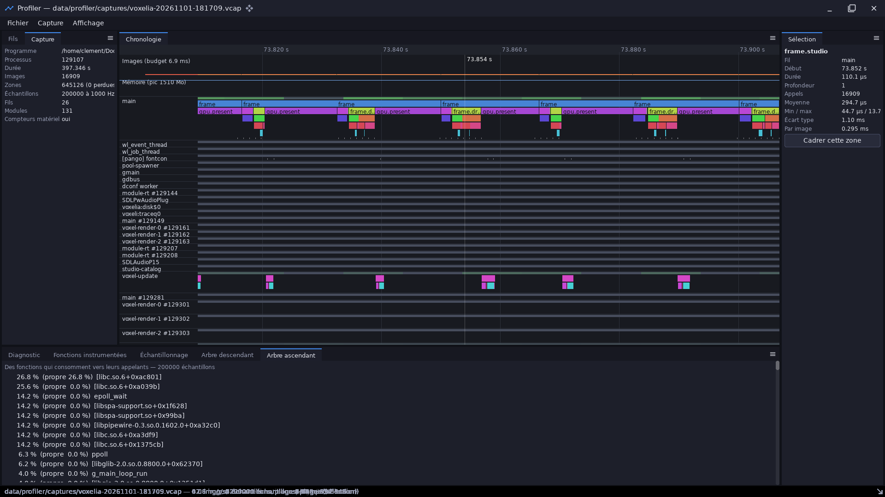

# profiler — profileur de programmes C++ instrumentés

`demos/profiler` · exécutable `profiler` · espace de noms `profiler::`

## Présentation

`profiler` analyse les performances d'un programme instrumenté avec
[`diagnostics::trace`](libs_foundation_diagnostics.md#capture-de-performances-tracehpp-diagnosticstrace).
Il s'inspire de [Google Orbit](https://github.com/google/orbit) et sert à
identifier les goulots d'étranglement : **CPU, mémoire, cache, GPU, fils**.

- **Capture** :
  - il lance le programme, ou s'attache à un programme déjà lancé, et
    produit un fichier `.vcap` (JSON) ;
  - capture complète, ou fenêtre délimitée par `--delay` et `--duration`,
    pilotée par `SIGUSR2`.
- **Symbolisation hors ligne** :
  - lecteur ELF64 (`.symtab`, sinon `.dynsym`, segments `PT_LOAD`) ;
  - noms C++ démêlés ;
  - lignes de source à la demande par `addr2line`.
- **Analyse** :
  - images : centiles, saccades et zones de la pire image ;
  - zones instrumentées : temps total, propre, minimum, maximum, écart type,
    par image ;
  - fils : temps CPU et états ;
  - échantillons de pile : fonctions, arbres descendant et ascendant ;
  - mémoire (croissance après la mise en route), cache (IPC, MPKI), GPU
    (attente à la présentation) ;
  - **diagnostic classé par gravité**.
- **Comparaison** de deux captures et **export Chrome Trace** (pour
  `chrome://tracing` ou `ui.perfetto.dev`).
- **Visualiseur** à la Orbit : chronologie par fil, docks, menus, réglages.



## Architecture

| Fichier (`src/`, `include/profiler/`) | Rôle |
|---|---|
| `capture.*` | Modèle `Capture` et lecteur dédié du format `.vcap` (`LoadCapture`, `ParseCapture`) |
| `symbols.*` | `ElfSymbols`, `Demangle`, `Symbolizer` |
| `analysis.*` | `Analyze`, `BuildCallTree`, `FormatReport`, `FormatCallTree`, `CompareReports`, `ExportChromeTrace` |
| `recorder.*` | `Record` (fork/exec puis `SIGUSR2`), `Attach` |
| `settings.*` | `Settings` (`data/profiler/settings.json`, créé au premier lancement) |
| `app.*`, `main.cpp` | Ligne de commande (`Run`, `Usage`) |
| `viewer.cpp` | Visualiseur (`RunViewer`) |

Modules utilisés : `core`, `diagnostics`, `dataio`, `math`, `ecs`, `sdl3`,
`render3d`, `ui`, `editor`.

## Utilisation

```sh
cpp-maker run -m profiler                       # ouvre le visualiseur (équivaut à « view »)
cpp-maker run -m profiler -- view capture.vcap  # ouvre une capture
cpp-maker run -m profiler -- record -- ./build/host/release/bin/voxelia --world=essai
cpp-maker run -m profiler -- report             # rapport de la capture la plus récente
```

| Commande | Rôle |
|---|---|
| `record [--out F] [--hz N] [--delay S --duration S] [--keep-running] -- programme args…` | Lance et capture (toute l'exécution, ou une fenêtre). `--keep-running` laisse tourner le programme après une capture pilotée |
| `list` | Captures du dossier, la plus récente d'abord |
| `attach PID --duration S` | Capture un programme déjà lancé avec `DIAG_TRACE_CONTROL=1` |
| `report F [--from MS --to MS] [--thread NOM|TID] [--target-fps N] [--top N]` | Diagnostic et statistiques |
| `tree F [--bottom-up] [--thread …] [--depth N] [--min POURCENT]` | Arbre d'appels des échantillons |
| `compare AVANT.vcap APRES.vcap` | Écarts entre deux captures |
| `export F --chrome SORTIE.json` | Chrome Trace |
| `view [F] [--frames N --screenshot P.png]` | Visualiseur. `profiler` seul, `profiler F.vcap` ou `profiler --option…` l'ouvrent aussi |

Sans fichier, les commandes prennent la capture la plus récente.
`--settings F` choisit un autre fichier de réglages.

### Visualiseur

- **Chronologie** :
  - piste des images, avec le budget dépassé en rouge ;
  - piste de la mémoire ;
  - pour chaque fil : sa bande d'état, ses zones empilées et ses marques
    d'échantillons.
- **Navigation** :
  - molette : zoom au curseur ;
  - glisser avec le bouton droit : défilement ;
  - glisser avec le bouton gauche : sélection d'une plage, que toutes les
    statistiques suivent ;
  - clic : sélection d'une zone ;
  - clavier : W/A/S/D/F, Origine, Échap.
- **Docks** :
  - Fils et Capture ;
  - Diagnostic, Fonctions instrumentées, Échantillonnage, Arbres ;
  - Sélection, avec les lignes de source les plus échantillonnées.
- **Menus** :
  - ouvrir, captures récentes, comparer, exporter ;
  - lancer et capturer, capturer un processus ;
  - **Fichier › Réglages…** (Ctrl+,).

### Réglages (`data/profiler/settings.json`)

| Clé | Défaut | Rôle |
|---|---|---|
| `capturesDirectory` | `data/profiler/captures` | Dossier des captures (`<programme>-<date>-<heure>.vcap`) |
| `samplingHz` | 1000 | Échantillons de pile par seconde de temps CPU |
| `targetFps` | 144 | Objectif d'images par seconde (diagnostic) |
| `top` | 20 | Lignes des rapports texte |
| `delaySeconds`, `durationSeconds` | 0, 0 | Fenêtre de capture par défaut (0 = toute l'exécution) |
| `stopAfterCapture` | `true` | Arrêter le programme après une capture pilotée |
| `lastCommand`, `recentCaptures` | — | Historique |

## Instrumenter un programme

Voir [diagnostics](libs_foundation_diagnostics.md). En bref :

```cpp
#include <diagnostics/trace.hpp>

int main() {
	bool running = true;
	int frame = 0;
	diagnostics::trace::StartFromEnvironment(); // DIAG_TRACE, DIAG_TRACE_HZ, DIAG_TRACE_CONTROL
	while (running) {
		DIAG_ZONE("frame");
		// …
		DIAG_FRAME();
		diagnostics::trace::PollControl();
		running = ++frame < 600; // SIGUSR2 : démarrer, arrêter
	}
	diagnostics::trace::FinishFromEnvironment();
}
```

`ecs` (une zone par système), `ui`, `render3d`, `voxel` et voxelia sont déjà
instrumentés. Voxelia Studio peut aussi lancer et arrêter un diagnostic
lui-même.

## Limites

- Les **compteurs matériels** sont refusés tant que
  `kernel.perf_event_paranoid` vaut plus de 2. La capture le signale et donne
  la commande pour les autoriser.
- Les fonctions internes de la libc, sans symbole exporté, restent affichées
  sous la forme `[libc.so.6+0x…]`.
- Il n'y a **pas de minutage GPU par requête**, car SDL_GPU n'expose pas les
  horodatages. Le GPU est mesuré par l'attente à la présentation et par la
  durée des rendus hors écran.
- La capture complète (échantillonnage, `/proc`, `SIGUSR2`) ne fonctionne
  que sous **Linux**.

## Tests

```sh
cpp-maker test -m profiler
```

Les 4 tests couvrent :

- l'analyse d'une capture synthétique ;
- la lecture ELF ;
- l'analyse d'une vraie capture du programme de test ;
- les réglages.
