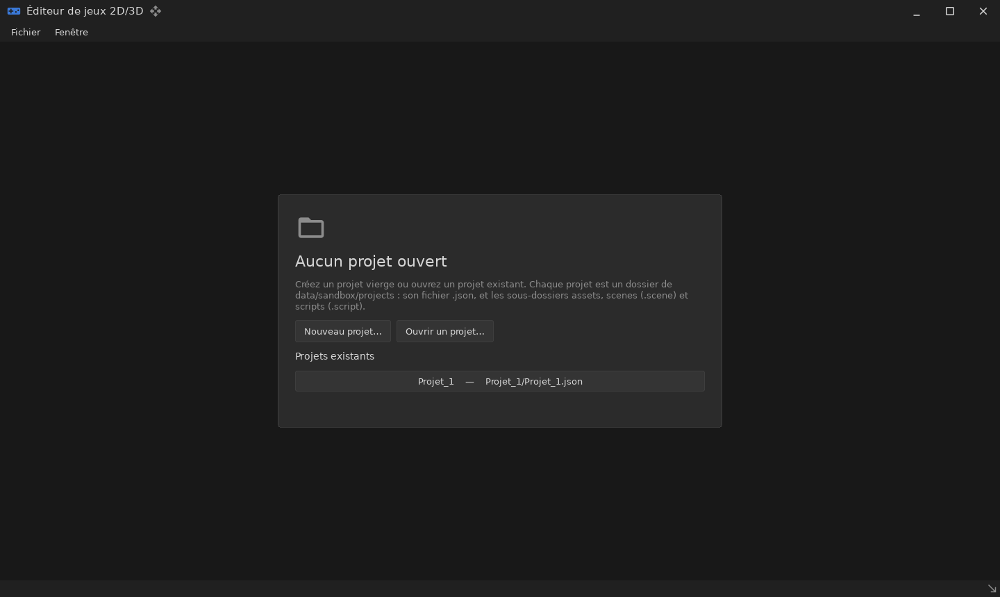
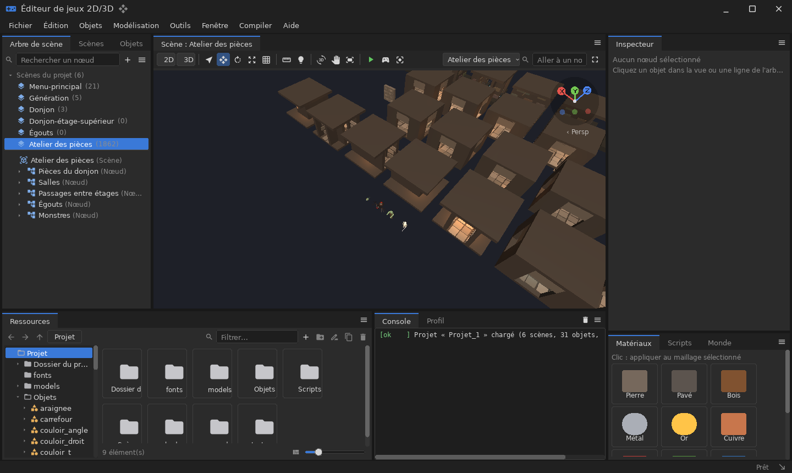
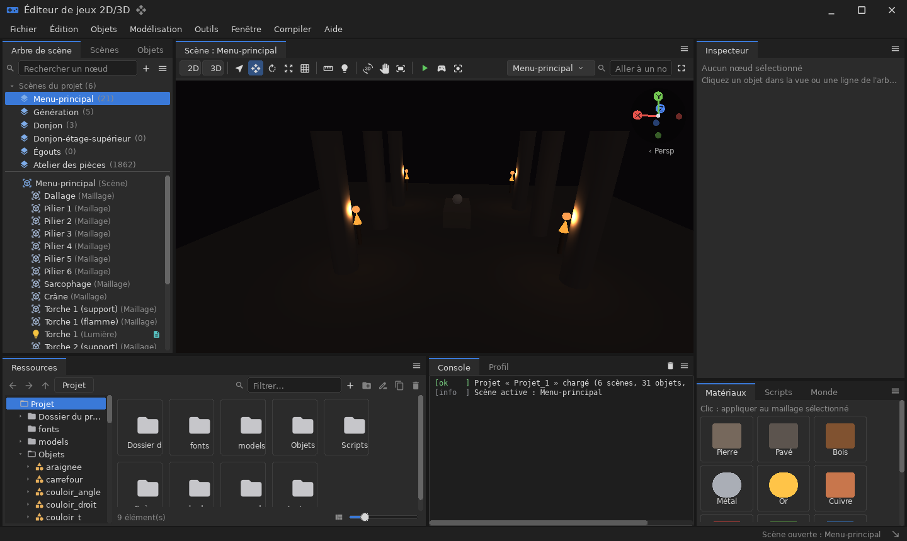
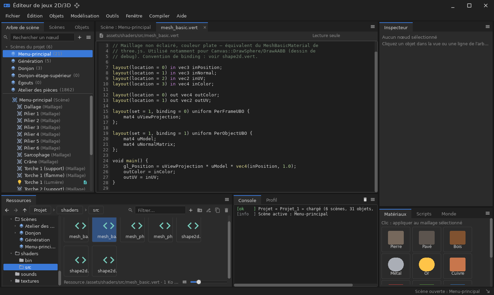
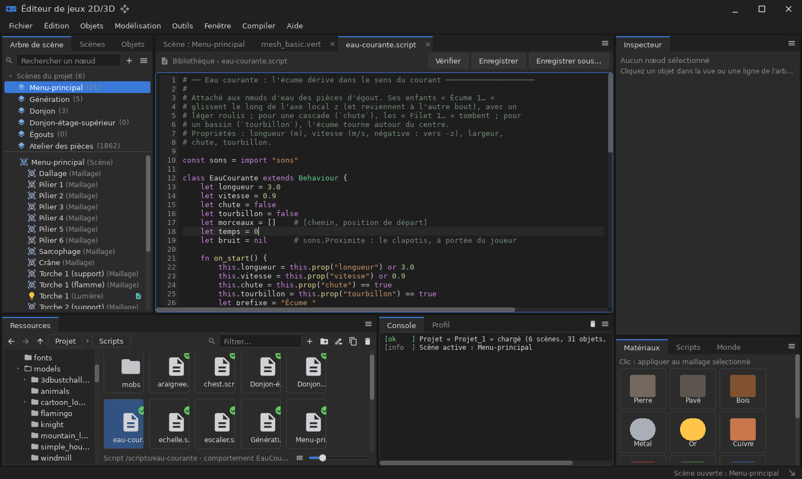
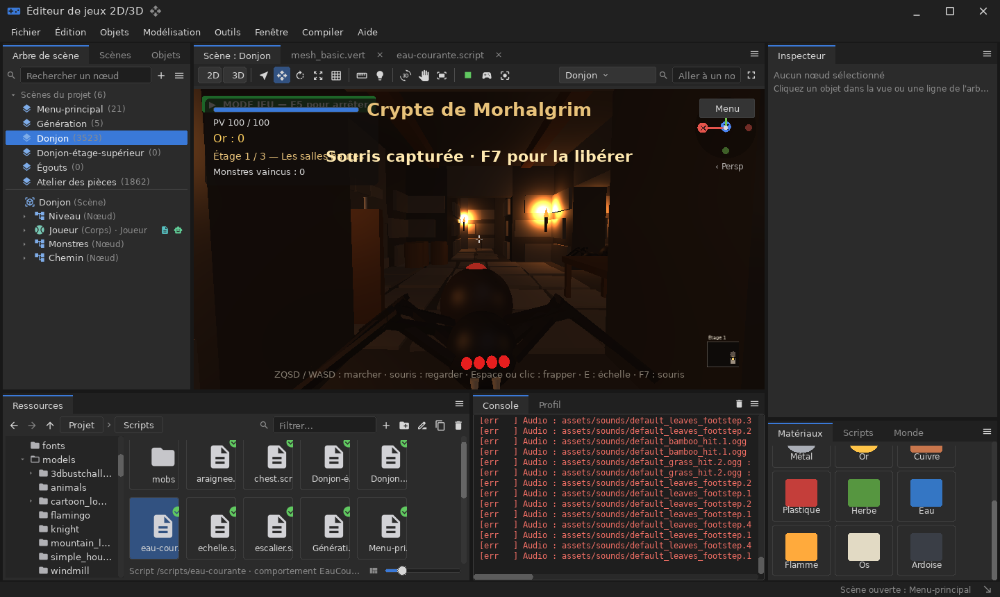
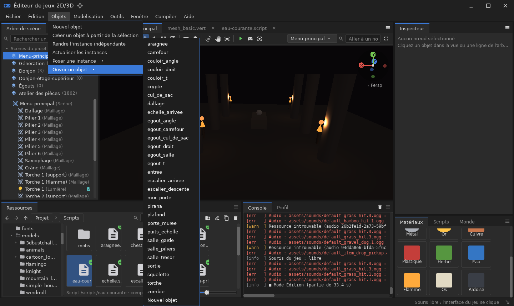

# sandbox — éditeur de jeux 2D/3D

`demos/sandbox` · exécutable `sandbox` · espace de noms `sandbox::`

## Présentation

La sandbox est un **éditeur de niveaux et de jeux 2D/3D** complet, dans
l'esprit de Blender, Godot ou Unreal. Elle sert de banc d'essai à presque
toute la bibliothèque :

- interface `ui` avec menus et docks à onglets ([`editor`](libs_infrastructure_editor.md)) ;
- vue 3D `render3d` avec manipulateur ;
- physique `physics` ;
- arbre de scène `scene` ;
- scripts `script` et `script_bindings` ;
- modélisation `modeling` ;
- ressources partagées `resources` et son `audio`.

**Fonctionnalités** :

- **Projets** : un dossier par projet dans `data/sandbox/projects/<nom>/`.
  - Le dossier contient le fichier `<nom>.json`, et les sous-dossiers
    `assets/`, `scenes/` (`.scene`), `scripts/` (`.script`) et les objets
    réutilisables (`.object`).
  - Chaque élément a une **adresse typée** : `/scenes/Donjon`,
    `/objects/Torche`, `/scripts/@Donjon`, `/assets/models/k.gltf`,
    `/scenes/Donjon/Joueur/Vue`.
- **Interface** :
  - arbre de scène à menu contextuel ;
  - navigateur de ressources à vignettes ;
  - inspecteur à sections ;
  - documents de code avec éditeur ;
  - console et profileur ;
  - thèmes `studio`, `dark`, `light` et `aero`.
- **Édition 3D** :
  - sélection au clic ;
  - manipulateur déplacer/tourner/redimensionner, avec magnétisme ;
  - annuler/rétablir ;
  - navigation orbitale, panoramique, molette et vol libre.
- **Objets réutilisables** : des arborescences de nœuds posées en instances
  qui suivent leurs modifications, imbrication comprise (les cycles sont
  refusés).
- **Mode Jeu** : la simulation tourne (physique, scripts, animations, son).
  Stop restaure l'état d'avant : jouer ne modifie jamais le projet
  enregistré.
- **Scripts de jeu** : un script **définit des classes** dérivées des bases
  C++ du moteur, que le moteur instancie :
  - `Scene`, `Behaviour` ;
  - `Node3D`, `Mesh3D`, `Node2D` ;
  - `PhysicsBody`, `Light3D` ;
  - `Gameplay` ;
  - `SceneAsset`, `ObjectAsset`.
- **Modélisation** à la SketchUp ([`modeling`](libs_infrastructure_modeling.md))
  dans un document de maillage.



| | |
|---|---|
|  |  |
|  |  |
|  |  |

## Architecture

| Dossier | Rôle |
|---|---|
| `src/app/` | `cli.cpp` (options), `app.cpp` (fenêtre, boucle, captures, mode sans écran), `scenarios.cpp` (scénarios scriptés), `report.cpp` (rapport texte/JSON) |
| `src/document/` | **Document** : projet, scènes, objets, fichiers, adresses (`project_fs`). Ne dépend ni de `render3d`, ni de `physics`, ni de `ui` |
| `src/engine/` | **Runtime** : document → scène vivante (`runtime.cpp`, `runtime2d.cpp`, `canvas2d*.cpp`), bibliothèque de maillages, bases des scripts (`script_owners.cpp`), plan d'un script (`script_outline.cpp`) |
| `src/editor/` | Interface : `panels.cpp`, `scene_tree.cpp`, `inspector.cpp`, `assets.cpp`, `asset_ops.cpp`, `documents.cpp`, `viewport_tools.cpp`, `modeling_session.cpp`, `modeling_ui.cpp`, `kit.cpp` |

Deux décisions de conception :

1. **Le document est distinct du runtime.**
   - Toute modification passe par une commande qui écrit d'abord dans le
     document, puis la répercute sur la scène vivante.
   - Sauvegarder revient à sérialiser le document.
   - L'interface, les scripts et le chargement suivent le même chemin.
2. **Le runtime ne tient qu'un `render3d::Canvas*` facultatif.** Sans lui,
   la scène, la physique, les scripts et le rapport fonctionnent à
   l'identique. C'est ce qui rend possibles le mode `--headless` et les
   tests sans GPU.

## Utilisation

```sh
cpp-maker run -m sandbox                                   # interface
cpp-maker run -m sandbox -- --project=Projet_1             # ouvrir un projet
cpp-maker run -m sandbox -- --help
```

| Catégorie | Options |
|---|---|
| Fenêtre | `--width=N` (1440), `--height=N` (860), `--theme=studio|dark|light|aero` |
| Pilotage | `--scene=NOM`, `--scenario=NOM`, `--script=CHEMIN`, `--project=CHEMIN` (dossier, `.json`, ou nom dans `DIR/projects`), `--frames=N`, `--seed=N`, `--jobs=N` (0 = tout sur le fil principal) |
| Observation | `--report=CHEMIN`, `--report-format=text|json`, `--screenshot=N:CHEMIN` (répétable), `--screenshot-dir=DIR`, `--assets-dir=DIR` (`assets`), `--saves-dir=DIR` (`data/sandbox`), `--verbose` |
| Modes | `--headless`, `--list-scenarios`, `--list-scenes`, `-h`/`--help` |

### Scénarios intégrés (`--scenario=NOM`)

| Nom | Contenu |
|---|---|
| `tour` | Visite guidée : panneaux, thèmes, édition, mode Jeu, 3 scènes (≈ 820 images) |
| `circuit` | Essai de jouabilité du circuit de voiture, en pilote automatique (≈ 1200) |
| `physics` | Banc d'essai du solveur physique sous charge croissante (≈ 900) |
| `themes` | Galerie des thèmes d'interface (≈ 160) |
| `stress` | Mesure de performance : vagues d'objets et images par seconde (≈ 600) |
| `edition` | Clic dans la vue, manipulateur, magnétisme, annulation (≈ 140) |
| `camera` | Navigation : orbite, plongée, molette, panoramique, vol libre (≈ 110) |
| `node_hierarchy` | Composition, reparentage, duplication, annulation, instances, aller-retour fichier (≈ 150) |
| `smoke` | Vérification minimale de chaque scène, pour l'intégration continue (≈ 150) |
| `interface` | Visite de l'interface dans le donjon (≈ 215) |

Exemples tirés de l'aide :

```sh
# Visite guidée complète, captures à chaque étape, rapport JSON
sandbox --scenario=tour --frames=600 --report=rapport.json --report-format=json

# Circuit de voiture jouable, vérifié sans écran
sandbox --headless --scenario=circuit --frames=1800 --report=circuit.txt

# Capture ponctuelle de l'interface
sandbox --frames=120 --screenshot=100:captures/ui.png
```

Le rapport décrit :

- les scènes et leurs objets ;
- les fils simultanés et la cadence (min, max, moyenne, centiles) ;
- les scripts exécutés et les compteurs de jeu (tours bouclés, meilleur
  tour) ;
- les captures, les avertissements et les erreurs.

### Exemple de script de jeu

Extrait de `demos/sandbox/tests/data/demo/scripts/Laboratoire physique.gameplay.script` :

```
# Une caisse larguée : un objet visible (Mesh3D) avec un corps dynamique
# (PhysicsBody). Elle disparaît avec la scène — ou plus tôt, par destroy().
class Caisse extends Mesh3D, PhysicsBody {
    fn init(numero) {
        let angle = numero * 0.7
        super.init("Caisse " .. numero, {
            shape: "box",
            size: [0.9, 0.9, 0.9],
            pos: [math.cos(angle) * 2.5, 9 + numero * 0.4, math.sin(angle) * 2.5],
            color: [80 + numero * 6, 200 - numero * 5, 120],
            material: "plastic",
            body: "dynamic",
            mass: 1.5,
            restitution: 0.25,
            friction: 0.6,
            tag: "debris"
        })
    }
}

class Laboratoire extends Scene {
    let t = 0
    let dropped = 0
    fn on_start() { … }
}
```

Une classe dérive au plus d'**une** classe de script et de plusieurs bases
de l'hôte. Le cycle de vie (`init`, `on_destroy`, `deinit`, `destroy()`) est
décrit dans [script](libs_infrastructure_script.md).

## Données

| Chemin | Rôle |
|---|---|
| `data/sandbox/projects/` | Projets de l'utilisateur (non versionné, `data/` étant ignoré par git) |
| `assets/` | Ressources partagées en lecture seule : modèles, textures, sons, polices |
| `demos/sandbox/tests/data/demo/` | Projet de démonstration utilisé par les tests et les scénarios |

## Tests

```sh
cpp-maker test -m sandbox
```

Les tests (156 au total) n'ont besoin d'aucun GPU. Ils couvrent :

- le document et les fichiers de projet, le système d'adresses ;
- les objets réutilisables et les pièces ;
- la 2D et l'audio ;
- les entrées et les maillages ;
- le runtime et les scripts.
