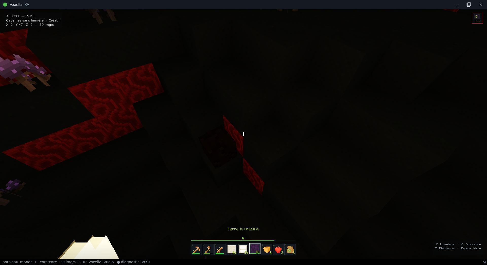
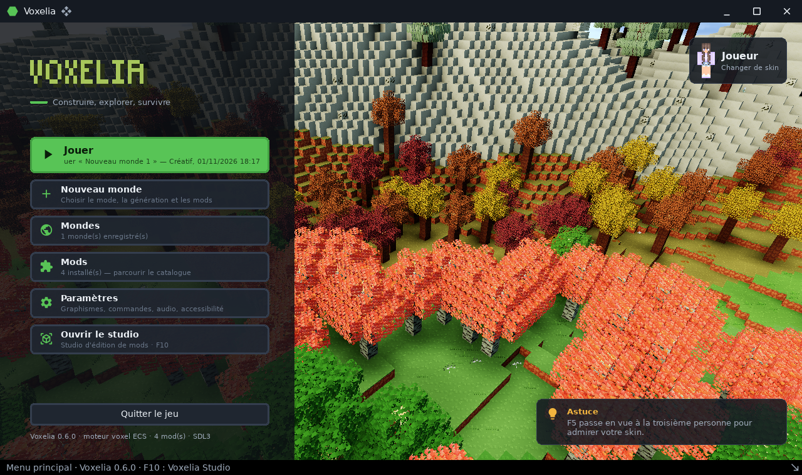
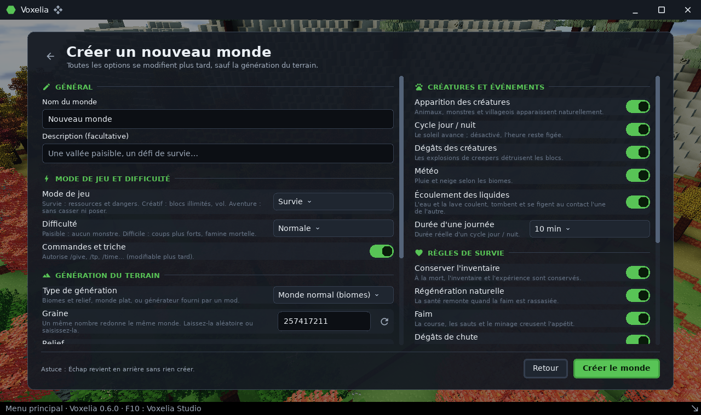
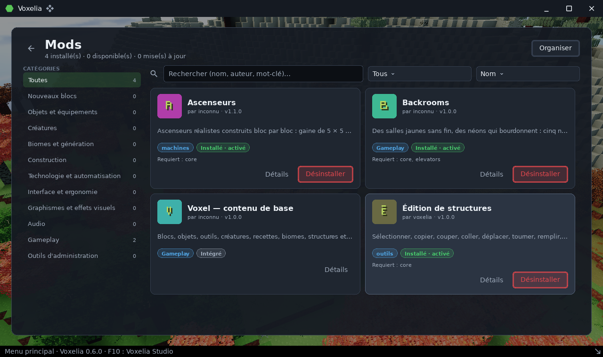
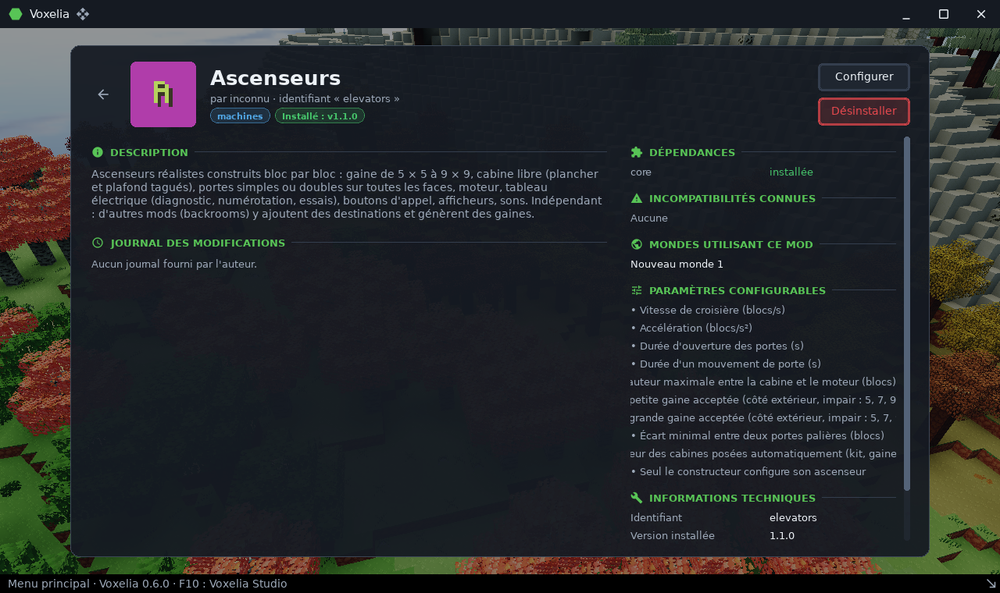
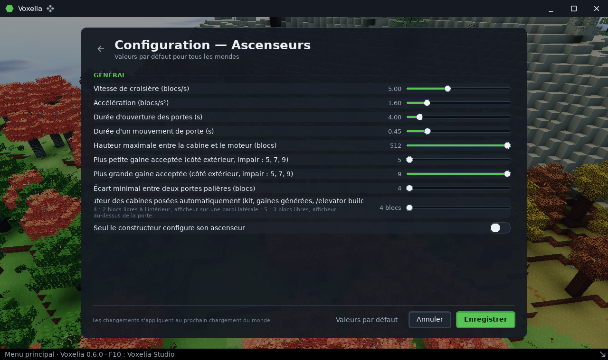
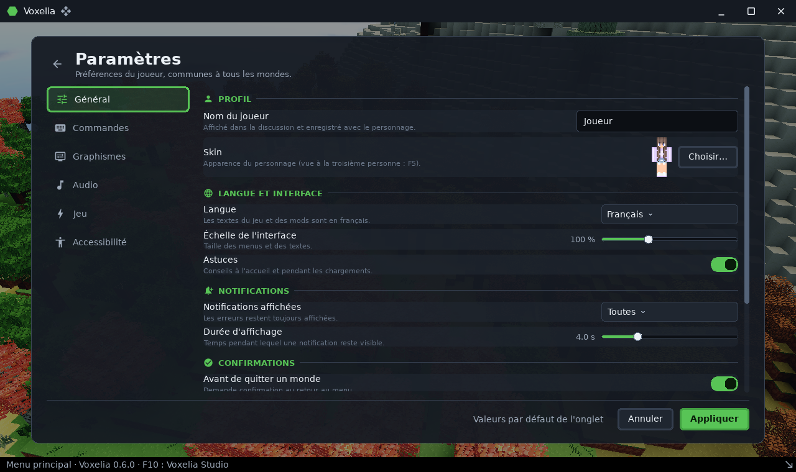
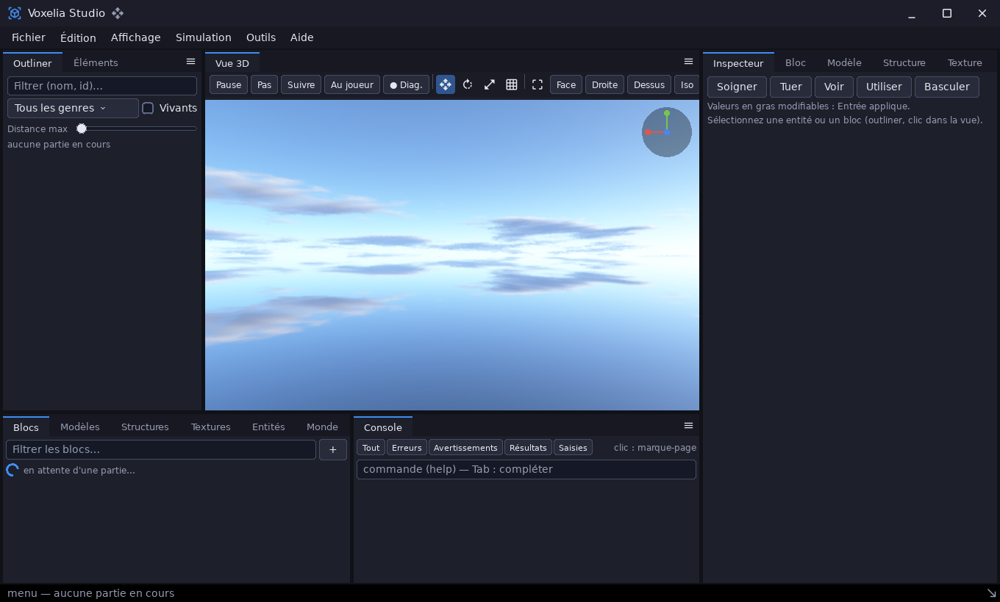
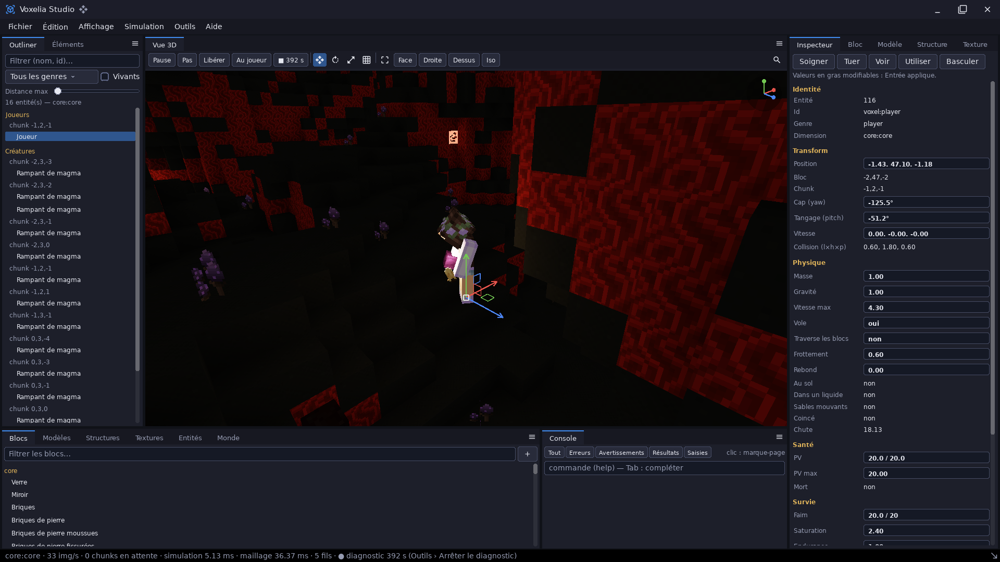
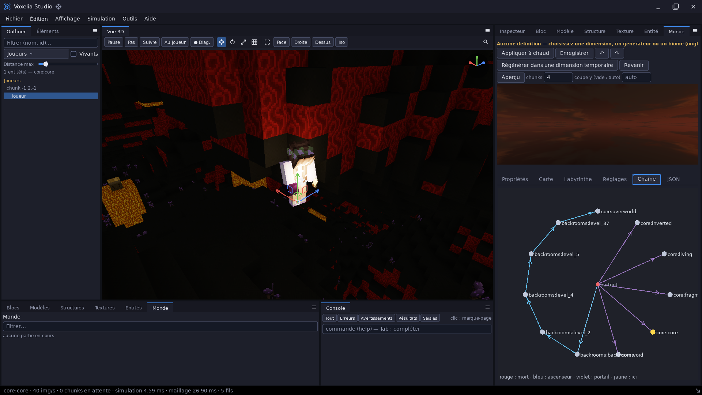

# voxelia — jeu voxel et Voxelia Studio

`demos/voxelia` · exécutable `voxelia` · espace de noms `voxelia::`

## Présentation

Voxelia est un **jeu voxel 3D piloté par les données**. Il s'appuie sur le
moteur [`voxel`](libs_infrastructure_voxel.md) : tout le contenu (blocs,
objets, créatures, recettes, biomes, structures, dimensions) vient de **mods**
en JSON et en scripts. L'application ajoute :

- le rendu ([`render3d`](libs_infrastructure_render3d.md), éclairage voxel
  précalculé, réflexions par lancer de rayons dans la grille de voxels) ;
- le son ([`audio`](libs_infrastructure_audio.md)), les entrées et
  l'interface ([`ui`](libs_infrastructure_ui.md)) ;
- les écrans de menu, de réglages, de gestion des mods et de jeu ;
- **Voxelia Studio**, un éditeur dans sa propre fenêtre, sur la **même
  partie**.



| | |
|---|---|
|  |  |
|  |  |
|  |  |

### Fonctionnalités du jeu (mods livrés)

| Mod | Contenu |
|---|---|
| `core` | Blocs, objets, outils, créatures, recettes, biomes, structures et générateurs ; liquides (sources, niveaux, écoulement, seaux, lave figée par l'eau) ; mobilier (portes, trappes, volets, échelles, lits, rangements, blocs de plusieurs cellules) ; blocs à états et capteurs ; sources de lumière ; plusieurs dimensions ; commandes `/day`, `/night`, `/sethome`, `/home`, `/house`, `/cook`… |
| `backrooms` | Niveaux des « backrooms » : générateur de labyrinthes à étages, textures haute résolution avec variantes, néons allumables, panneaux EXIT, ambiances sonores ; on y arrive après une mort par suffocation |
| `elevators` | Ascenseurs : cabine mobile qui emporte ses passagers, portes coulissantes, appels, afficheurs, transfert entre dimensions |
| `edit` | Édition de structures : copier, coller, déplacer, remplir, remplacer ; formes et formules ; fichiers de structures (`.vxs.json`, `.json`, WorldEdit, Minetest `.mts`) |

Le joueur est visible comme toute entité. La caméra peut passer en première
ou en troisième personne, et le joueur tient un objet dans chaque main.

### Voxelia Studio

Le studio (touche **F10**) est un éditeur dans une seconde fenêtre. Son
interface reprend celle de la sandbox : module
[`editor`](libs_infrastructure_editor.md), docks, navigation orbitale, gizmo,
palette de commandes (F1 ou Ctrl+Maj+P) et `WindowFrame`.

Il travaille sur la partie en cours, avec :

- un outliner des entités, un inspecteur modifiable (entités et blocs) et
  une vue 3D partagée ;
- une console filtrée ;
- des éditeurs de **blocs** (nodebox, rechargement à chaud), de **modèles
  articulés** (animation, Bézier, mélange de clips, export glTF), de
  **structures** (formules, collage avec fantôme), de **textures**
  (peinture en calques, variantes, lueur, atlas), d'**entités** (IA, aperçu
  de comportement dans une arène) et du **monde** (biomes, générateurs,
  dimensions) ;
- un **diagnostic** de performances : démarrer et arrêter une capture
  `.vcap`, exportée automatiquement, et aussi à la fermeture du jeu. Voir le
  [profiler](demo_profiler.md).



| | |
|---|---|
|  |  |

## Architecture

| Fichier | Rôle |
|---|---|
| `src/main.cpp`, `src/app.cpp` | Options, fenêtres (`ui::WindowManager` : jeu et studio sur un seul périphérique GPU), boucle, rapport, capture de performances |
| `src/shell.cpp` | Coquille de la fenêtre de jeu : cadre, couches de la zone de jeu (vue 3D, HUD, écrans, notifications), ouverture du studio, diagnostic |
| `src/session.cpp` | Partie en cours : chargement à budget de temps (~20 ms par image), commandes |
| `src/worker.cpp` | **Fil de simulation**, orchestré par le fil principal |
| `src/world_renderer.cpp`, `src/reflections.cpp` | Maillage des chunks sur des fils dédiés, à partir d'instantanés du monde ; envoi au GPU ; réflexions |
| `src/catalog.cpp` | Catalogue des blocs (vignettes), sur son propre fil |
| `src/settings.cpp` | Préférences (`data/voxelia/settings.json`) : touches, graphismes, son |
| `src/ui/` | Kit d'interface et écrans : menu, jeu, mods, réglages, système |
| `src/studio/` | Voxelia Studio : `studio.cpp`, `outliner.cpp`, `console.cpp`, `report.cpp`, et un document et un éditeur par type de contenu (`block_*`, `model_editor`, `rig_document`, `structure_*`, `texture_*`, `entity_*`, `worldgen_document`, `definition_document`) |
| `mods/` | Les mods livrés |

**Fils d'exécution** :

- le fil principal gère les fenêtres, l'interface et le rendu ;
- un fil de simulation fait avancer la partie ;
- 2 à 6 fils de maillage (cœurs logiques / 2 − 1) préparent les chunks ;
- la vue 3D est affichée sans aller-retour GPU → CPU (mode `direct`).

Modules utilisés : `core`, `diagnostics`, `math`, `events`, `dataio`,
`ecs`, `editor`, `resources`, `script`, `voxel`, `render3d`, `ui`, `audio`,
`sdl3`.

## Utilisation

> Lancez voxelia **depuis la racine du dépôt** : les mods, les ressources et
> les données sont désignés par des chemins relatifs.

```sh
cpp-maker run -m voxelia                                        # menu principal
cpp-maker run -m voxelia -- --world=essai --creative            # monde direct
cpp-maker run -m voxelia -- --studio                            # avec le studio
cpp-maker run release -m voxelia                                # optimisé
```

| Option | Rôle |
|---|---|
| `--world=DOSSIER`, `--seed=N`, `--generator=ID` | Joue ce monde (créé s'il n'existe pas) ; générateurs `core:overworld`, `core:flat`, `core:islands`… |
| `--mods=DIR` (répétable), `--repository=DIR`, `--saves=DIR`, `--structures=DIR`, `--settings=FICHIER` | Dossiers ; défauts : `demos/voxelia/mods`, `demos/voxelia/repository`, `data/voxelia/saves`, `data/voxelia/settings.json` |
| `--view=N`, `--creative` | Distance d'affichage (sans fenêtre) ; mode créatif |
| `--frames=N`, `--screenshot=N:FICHIER`, `--exec=N:/commande`, `--exec=N:!commande` | Pilotage : commande de jeu, ou commande de l'application (`!screen`, `!play`, `!back`, `!home`, `!look`, `!view`, `!notify`, `!confirm`, `!set`…) |
| `--headless` | Sans fenêtre : simulation, commandes, rapport |
| `--threads=on|off`, `--mesh-threads=N`, `--viewport=direct|pipelined|readback` | Fils et mode d'affichage de la vue 3D |
| `--width=W --height=H` | Taille de la fenêtre |
| `--studio`, `--studio-display=N`, `--studio-screenshot=N:FICHIER`, `--screenshot-desktop=N:FICHIER`, `--exec=N:!studio LIGNE` | Studio |
| `--report=FICHIER` | Rapport d'exécution (texte, et `FICHIER.json`) |

> Le dossier `demos/voxelia/repository` (mods disponibles à l'installation)
> n'existe pas dans le dépôt actuel : l'écran d'installation est alors vide.

### Touches par défaut

Les touches se modifient dans Réglages › Commandes.

| Touche | Action |
|---|---|
| ZQSD / WASD, souris, Espace, Maj, Ctrl | Déplacement |
| F | Vol |
| E | Inventaire |
| C | Fabrication |
| T | Discussion |
| / | Terminal |
| Tab | Informations |
| Échap | Pause |
| F1 | Masquer l'interface |
| F2 | Capture |
| F3 | Informations techniques |
| F5 | Changer de vue |
| F6 | Enregistrer |
| F10 | Voxelia Studio |
| Ctrl+Q | Quitter (toutes les fenêtres) |

Commandes de la console du studio :

- sélection et caméra : `studio.select player|<entité>|<nom>`,
  `studio.deselect`, `studio.focus`, `studio.follow`,
  `studio.camera player|x y z` ;
- temps : `studio.pause`, `studio.play`, `studio.step [n]` ;
- entités : `studio.heal`, `studio.kill` ;
- performances : `studio.stats`, `studio.diag`, `studio.diag.start`,
  `studio.diag.stop` ;
- `help`.

Toute autre ligne est passée à la console du jeu.

### Capture de performances

```sh
DIAG_TRACE=data/profiler/captures/voxelia.vcap cpp-maker run release -m voxelia
```

Le studio peut aussi démarrer et arrêter un diagnostic. Le fichier est écrit
dans `data/profiler/captures/voxelia-<date>-<heure>.vcap`, ou dans le
dossier choisi dans `data/profiler/settings.json`.

## Données

| Chemin | Contenu |
|---|---|
| `data/voxelia/settings.json` | Préférences |
| `data/voxelia/saves/<monde>/` | Un dossier par monde : `world.json`, chunks, entités, structures, base `world.db` |
| `data/voxelia/screenshots/`, `backups/`, `cache/` | Captures, sauvegardes de sécurité, cache |
| `demos/voxelia/mods/` | Mods livrés (versionnés) |

## Performances mesurées

Mesures sur un GPU intégré Intel Iris Xe, 4 cœurs / 8 fils (±15 % d'une
exécution à l'autre) :

| Cas | Images/s |
|---|---|
| debug, monde plat + studio | ≈ 108 |
| release, monde plat + studio | ≈ 210 |
| release, overworld, jeu seul | ≈ 150 |
| release, overworld + studio | 95 à 120 |

Le chargement d'un monde demande environ 120 images en debug.

Ce qui limite encore :

- la présentation (attente du GPU intégré) ;
- le monde rendu deux fois quand le studio est ouvert.

## Travaux restants du studio

Le studio est construit par étapes. Les étapes 0 à 8 sont faites ; ce qui
suit ne l'est pas encore.

- **Rechargement** : `reload all | texture | script` est prévu à l'étape 9,
  avec un gestionnaire de mods.
- **Inspecteur** :
  - le contenu d'un rangement est listé, pas modifiable ;
  - l'inspecteur n'existe pas en fenêtre séparée ;
  - les entités ne portent pas de classes de script.
- **Structures** : un `Schematic` ne porte que des blocs et des rangements
  (ni entités ni références à d'autres structures). Le collage se fait au
  bloc visé ou à des coordonnées, pas par glisser-déposer dans la vue.
- **Textures** :
  - pas de peinture directe sur le modèle 3D ;
  - pas de renommage d'une variante ;
  - le JSON d'une texture procédurale ou composée n'est pas réécrit par
    l'enregistrement.
- **Entités** :
  - les animations se modifient dans l'atelier de modèles ;
  - l'arène d'aperçu est construite dans le monde courant ;
  - les paramètres d'IA se saisissent en « clé valeur ».
- **Monde** :
  - pas d'édition point par point de la carte des biomes ;
  - pas de portails créés à la volée ;
  - les gaines des labyrinthes sont listées, pas dessinées ;
  - la dimension temporaire reste dans la sauvegarde.

## Tests

```sh
cpp-maker test -m voxelia            # délai porté à 1800 s dans module.toml
```

Les tests couvrent les ascenseurs, les mods, les réglages et chaque éditeur
du studio : blocs, entités, rigs, structures, textures, génération du monde.
