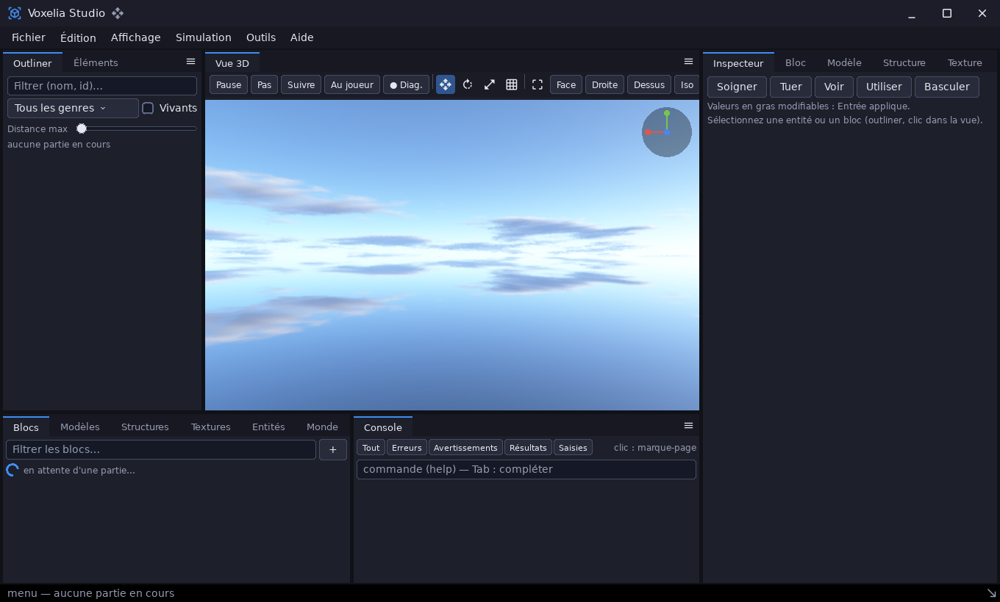
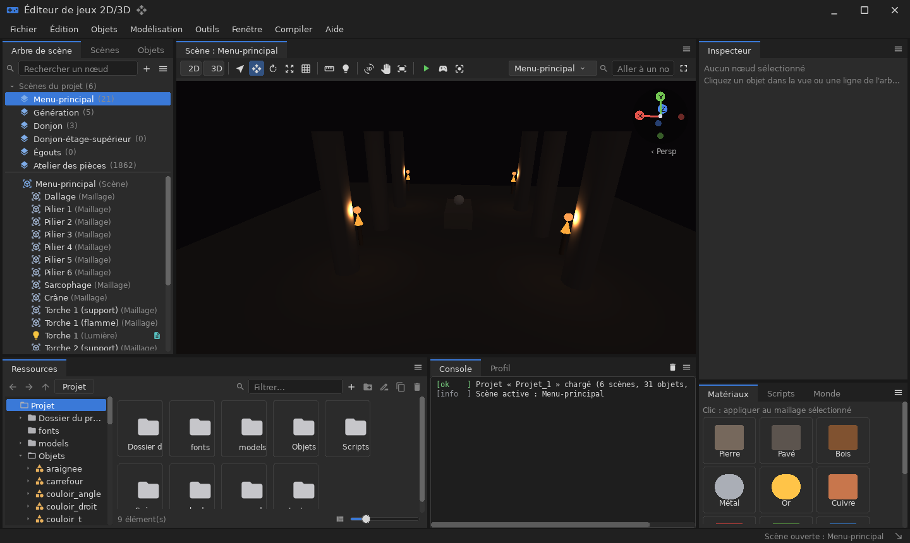
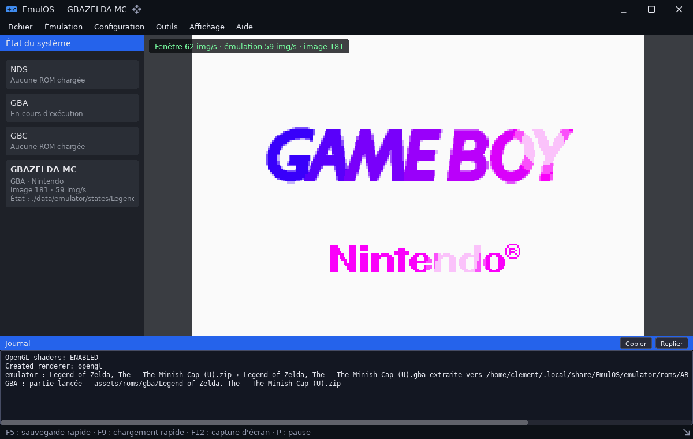
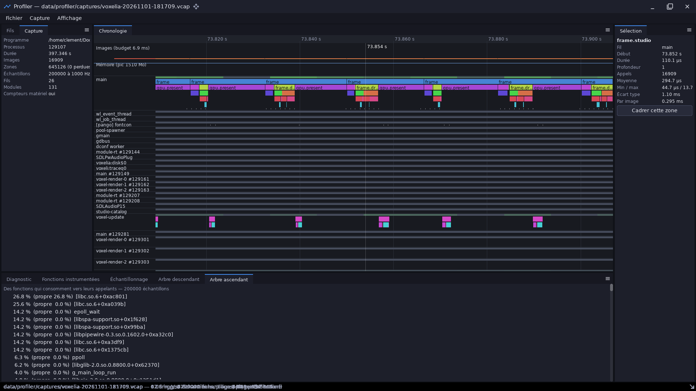

# Démos

Le dossier `demos/` contient **quatre applications complètes**. Chacune sert
de banc d'essai à une grande partie de la bibliothèque. Elles sont toutes
pilotables en ligne de commande : nombre d'images, captures, rapport
d'exécution, mode sans écran. On peut donc les vérifier automatiquement.

| Démo | Résumé | Modules principaux |
|---|---|---|
| [emulator](demo_emulator.md) | Émulateur Nintendo DS, GBA et GBC (cœur dérivé de NooDS) dans la coquille « EmulOS » ; ROMs lancées depuis des archives | `ui`, `archive`, `sdl3` |
| [sandbox](demo_sandbox.md) | Éditeur de jeux 2D/3D : projets, scènes, objets réutilisables, scripts de jeu en classes, physique, modélisation | `ui`, `editor`, `render3d`, `physics`, `scene`, `script_bindings`, `modeling`, `audio` |
| [voxelia](demo_voxelia.md) | Jeu voxel piloté par des mods (JSON et scripts), avec Voxelia Studio, un éditeur dans une seconde fenêtre | `voxel`, `render3d`, `ui`, `editor`, `audio` |
| [profiler](demo_profiler.md) | Profileur de programmes instrumentés, inspiré de Google Orbit : capture, chronologie, échantillonnage, diagnostic | `diagnostics`, `ui`, `editor`, `dataio` |

```sh
cpp-maker run -m <démo> [-- options]          # debug
cpp-maker run release -m <démo> [-- options]  # optimisé (recommandé pour voxelia)
cpp-maker run -m <démo> -- --help              # options de chaque démo
```

Les démos lisent leurs ressources dans `assets/` et écrivent leurs données
dans `data/<démo>/`, qui n'est pas versionné. Lancez-les **depuis la racine
du dépôt**.

| | |
|---|---|
|  |  |
|  |  |
