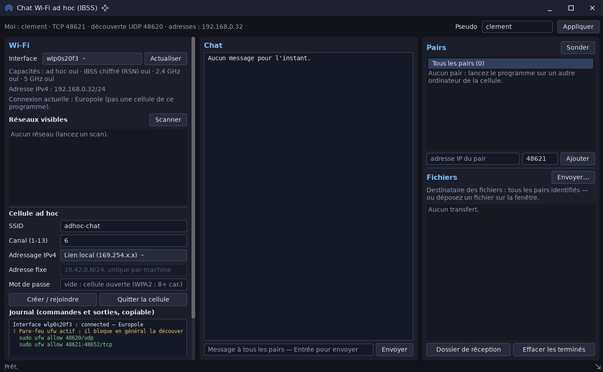

# adhoc_chat_demo — chat et fichiers sur un réseau local ou une cellule Wi-Fi ad hoc

`examples/adhoc_chat_demo` · exécutable `adhoc_chat_demo` · un seul fichier : [`src/main.cpp`](../examples/adhoc_chat_demo/src/main.cpp) (1103 lignes)

> Chat et échange de fichiers entre ordinateurs d'un même réseau local (net::)

## Présentation

Chat et échange de fichiers entre ordinateurs reliés par une cellule Wi-Fi
IBSS (« ad hoc »), sans point d'accès ni serveur, ou par n'importe quel réseau
local. Toute la partie réseau est dans la bibliothèque
([net](libs_infrastructure_net.md)) : cet exemple n'est que l'interface.

La fenêtre a trois colonnes :

- **Wi-Fi** :
  - interfaces et capacités de la carte, scan des réseaux (un clic recopie
    le SSID et le canal) ;
  - création ou adhésion à une cellule, et départ, via NetworkManager
    (`nmcli`) ;
  - le journal montre chaque commande et sa sortie. Si les droits manquent,
    il donne les commandes à lancer en administrateur, et il signale un
    pare-feu actif.
- **Chat** : messages, arrivées et départs, fichiers reçus.
- **Pairs et fichiers** :
  - voisins découverts par diffusion UDP (« Sonder ») et ajout manuel ;
  - envoi d'un fichier par le bouton ou par glisser-déposer ;
  - progression, débit et annulation des transferts.

Les commandes `nmcli` bloquent pendant quelques secondes. Elles tournent dans
des tâches `std::async`, dont l'interface relève le résultat.



## Modules utilisés

[`core`](libs_foundation_core.md), [`net`](libs_infrastructure_net.md), [`sdl3`](libs_infrastructure_sdl3.md), [`ui`](libs_infrastructure_ui.md)

## Lancer

```sh
cpp-maker run -m adhoc_chat_demo -- --nick Ada
```

| Option | Rôle |
|---|---|
| `--nick NOM` | Pseudo (défaut : `$USER`) |
| `--discovery-port N` | Port UDP de découverte (48620) |
| `--tcp-port N` | Premier port TCP essayé (48621) |
| `--download-dir DOSSIER` | Fichiers reçus (`~/Téléchargements/adhoc_chat`) |
| `--peer HÔTE[:PORT]` | Pair à joindre directement (répétable) |
| `--no-broadcast` | Pas de découverte par diffusion |
| `--no-wifi` | Ne lance pas `nmcli` (chat sur le réseau actuel) |
| `--device IFACE` | Interface Wi-Fi à utiliser |

Pour un essai sur une seule machine, lancez deux fois le programme. La
seconde instance prend le port TCP suivant, et les deux se découvrent, ou se
joignent avec `--peer 127.0.0.1:48621`.

Comme toutes les applications du dépôt, l'exemple se lance **depuis la
racine du dépôt** : polices, shaders et ressources sont lus dans `assets/`.
