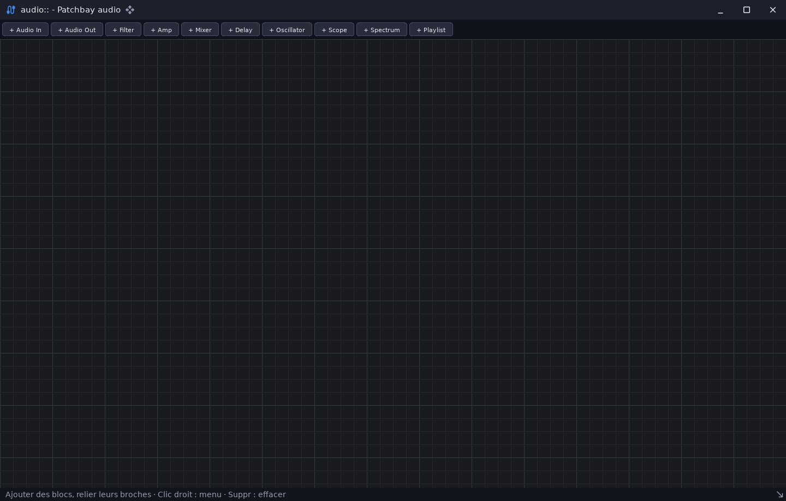

# audio_patchbay — routage audio par graphe de nœuds

`examples/audio_patchbay` · exécutable `audio_patchbay` · un seul fichier : [`src/main.cpp`](../examples/audio_patchbay/src/main.cpp) (1037 lignes)

> Routage audio par node-graph (ui::nodegraph + audio::dsp)

## Présentation

Un studio de routage audio. Les blocs se relient dans un éditeur de graphe
de nœuds ([`ui::nodegraph`](libs_infrastructure_ui.md)) :

- Audio In, Audio Out ;
- Filter, Amp, Mixer, Delay, Oscillator ;
- Scope, Spectrum (un `ui::Plot`) ;
- Playlist : décodage multi-format par `sdl3::AudioDecoder`, choix des
  fichiers par le dialogue natif `sdl3::dialog`.

Le traitement réel ([`audio::dsp`](libs_infrastructure_audio.md)) est un
modèle de données **séparé de l'ECS**. Seule sa structure (`dsp::Graph`,
protégée par un `sdl3::Mutex`) est partagée entre le fil de l'interface et
le fil audio.



## Modules utilisés

[`audio`](libs_infrastructure_audio.md), [`core`](libs_foundation_core.md), [`sdl3`](libs_infrastructure_sdl3.md), [`ui`](libs_infrastructure_ui.md)

## Lancer

```sh
cpp-maker run -m audio_patchbay
```

Comme toutes les applications du dépôt, l'exemple se lance **depuis la
racine du dépôt** : polices, shaders et ressources sont lus dans `assets/`.
