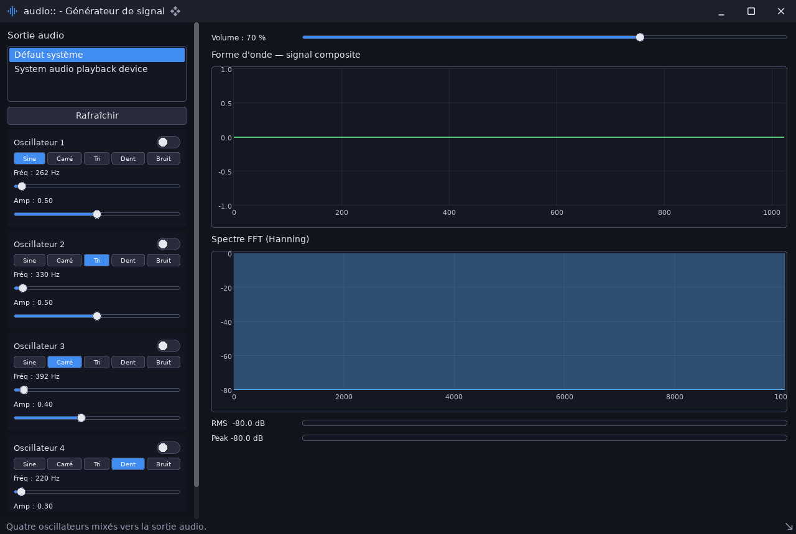

# audio_signal_generator — générateur de signaux

`examples/audio_signal_generator` · exécutable `audio_signal_generator` · un seul fichier : [`src/main.cpp`](../examples/audio_signal_generator/src/main.cpp) (374 lignes)

> Générateur de signaux : 4 oscillateurs paramétrables (audio::dsp)

## Présentation

Quatre oscillateurs paramétrables (forme, fréquence, amplitude, marche/arrêt)
et un volume général. La fenêtre affiche aussi :

- la forme d'onde composite et son spectre (deux `ui::Plot`) ;
- des VU-mètres RMS et crête (`ui::Progress`).

La synthèse se fait par accumulateur de phase ; la sortie passe par
`sdl3::AudioStream`. Le comportement reprend celui de l'exemple équivalent de
SDL3pp, avec les widgets de ce dépôt.



## Modules utilisés

[`audio`](libs_infrastructure_audio.md), [`core`](libs_foundation_core.md), [`sdl3`](libs_infrastructure_sdl3.md), [`ui`](libs_infrastructure_ui.md)

## Lancer

```sh
cpp-maker run -m audio_signal_generator
```

Comme toutes les applications du dépôt, l'exemple se lance **depuis la
racine du dépôt** : polices, shaders et ressources sont lus dans `assets/`.
