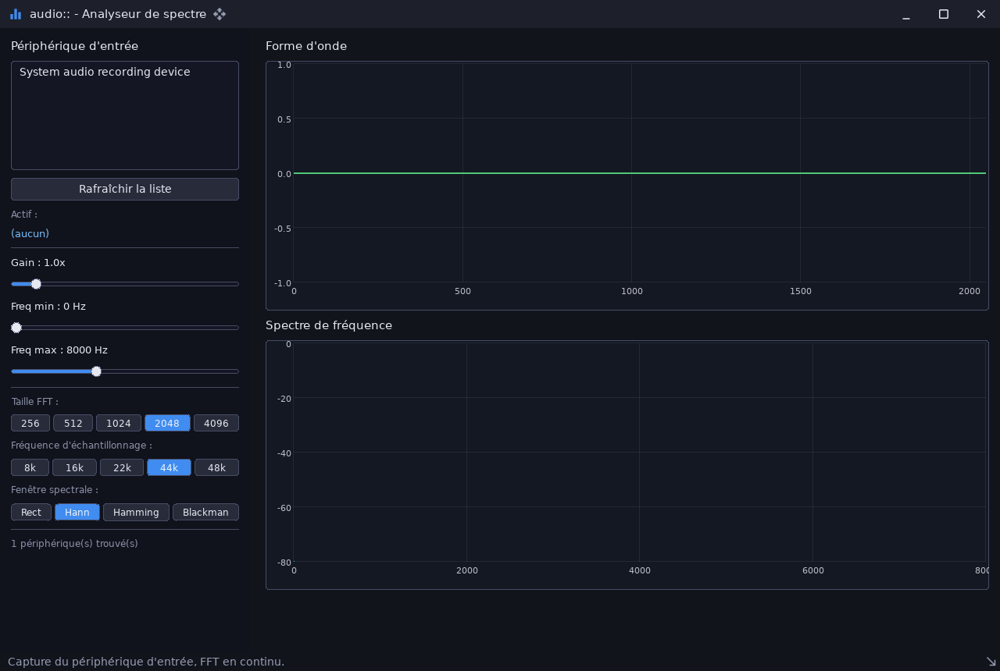

# audio_spectrum_analyzer — analyseur de spectre temps réel

`examples/audio_spectrum_analyzer` · exécutable `audio_spectrum_analyzer` · un seul fichier : [`src/main.cpp`](../examples/audio_spectrum_analyzer/src/main.cpp) (332 lignes)

> Analyseur de spectre temps réel (audio::dsp + ui::plot)

## Présentation

Analyseur de spectre sur un périphérique d'**enregistrement** (micro). On
choisit :

- le périphérique et le gain ;
- la plage de fréquences ;
- des préréglages de taille de FFT, de fréquence d'échantillonnage et de
  fenêtre.

La forme d'onde et le spectre sont mis à jour à chaque image par
`PlotSeries::SetY` et `SetXy` ; l'analyse utilise
[`audio::dsp`](libs_infrastructure_audio.md).



## Modules utilisés

[`audio`](libs_infrastructure_audio.md), [`core`](libs_foundation_core.md), [`sdl3`](libs_infrastructure_sdl3.md), [`ui`](libs_infrastructure_ui.md)

## Lancer

```sh
cpp-maker run -m audio_spectrum_analyzer
```

Sans micro, la liste des périphériques est vide.

Comme toutes les applications du dépôt, l'exemple se lance **depuis la
racine du dépôt** : polices, shaders et ressources sont lus dans `assets/`.
