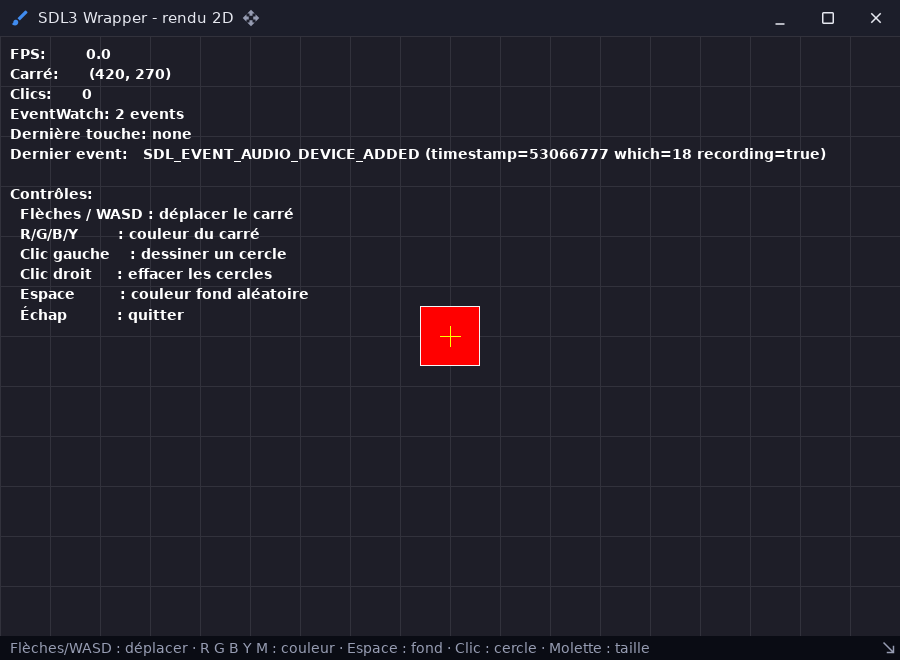

# renderer — rendu 2D avec sdl3::Renderer

`examples/renderer` · exécutable `renderer` · un seul fichier : [`src/main.cpp`](../examples/renderer/src/main.cpp) (385 lignes)

> Renderer 2D SDL (sdl3::Renderer) : formes, textures, texte

## Présentation

Démonstration du rendu 2D de [sdl3](libs_infrastructure_sdl3.md) :

- formes, textures et texte (`Font`, `TextEngine`, `Text`) ;
- évènements clavier et souris, et `EventWatch` ;
- un bloc d'informations : images par seconde, position, dernier évènement.

La scène est dessinée dans un viewport limité à la zone de contenu d'un
`ui::WindowFrame`.



## Modules utilisés

[`core`](libs_foundation_core.md), [`sdl3`](libs_infrastructure_sdl3.md), [`ui`](libs_infrastructure_ui.md)

## Lancer

```sh
cpp-maker run -m renderer
```

| Touche | Action |
|---|---|
| Flèches / WASD | Déplacer le carré |
| R / G / B / Y | Couleur du carré |
| Clic gauche | Dessiner un cercle |
| Clic droit | Effacer les cercles |
| Espace | Couleur de fond aléatoire |
| Échap | Quitter |

Comme toutes les applications du dépôt, l'exemple se lance **depuis la
racine du dépôt** : polices, shaders et ressources sont lus dans `assets/`.
