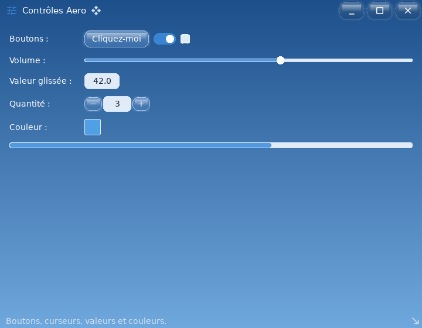

# ui_aero_basics — thème Frutiger Aero : widgets de base

`examples/ui_aero_basics` · exécutable `ui_aero_basics` · un seul fichier : [`src/main.cpp`](../examples/ui_aero_basics/src/main.cpp) (125 lignes)

> Thème Frutiger Aero, fenêtre sans bordure : widgets de base

## Présentation

Thème Frutiger Aero (dans l'esprit de Windows 7), dans une fenêtre sans
décoration système dont la barre de titre en verre est dessinée par
l'interface.

Contrôles présentés :

- boutons, interrupteur, case à cocher, curseur ;
- `DragValue` (double clic pour taper une valeur) et `NumberInput` (− / +) ;
- pastille de couleur qui ouvre un `ColorPicker`.

Le fond en dégradé vient d'une feuille CSS.



## Modules utilisés

[`core`](libs_foundation_core.md), [`sdl3`](libs_infrastructure_sdl3.md), [`ui`](libs_infrastructure_ui.md)

## Lancer

```sh
cpp-maker run -m ui_aero_basics
```

Comme toutes les applications du dépôt, l'exemple se lance **depuis la
racine du dépôt** : polices, shaders et ressources sont lus dans `assets/`.
