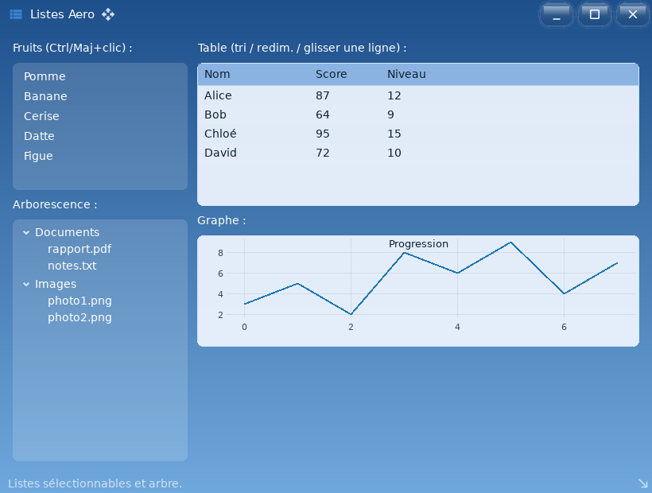

# ui_aero_lists — thème Frutiger Aero : listes, arbres et tableaux

`examples/ui_aero_lists` · exécutable `ui_aero_lists` · un seul fichier : [`src/main.cpp`](../examples/ui_aero_lists/src/main.cpp) (123 lignes)

> Thème Frutiger Aero : listes, arbres et tableaux

## Présentation

Dans le même thème :

- `Selectable` avec sélection multiple (Ctrl ou Maj + clic) ;
- `TreeNode` imbriqués ;
- `Table` triable, redimensionnable et réordonnable ;
- graphe en lignes.



## Modules utilisés

[`core`](libs_foundation_core.md), [`sdl3`](libs_infrastructure_sdl3.md), [`ui`](libs_infrastructure_ui.md)

## Lancer

```sh
cpp-maker run -m ui_aero_lists
```

Comme toutes les applications du dépôt, l'exemple se lance **depuis la
racine du dépôt** : polices, shaders et ressources sont lus dans `assets/`.
