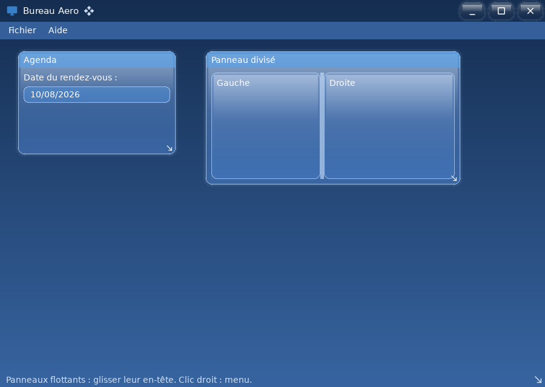

# ui_aero_windows — thème Frutiger Aero : bureau et fenêtres internes

`examples/ui_aero_windows` · exécutable `ui_aero_windows` · un seul fichier : [`src/main.cpp`](../examples/ui_aero_windows/src/main.cpp) (148 lignes)

> Thème Frutiger Aero : bureau et fenêtres internes

## Présentation

Un « bureau simulé » :

- barre de menus ;
- panneaux flottants déplaçables et redimensionnables ;
- menu contextuel (clic droit sur le bureau) et boîte de dialogue modale ;
- séparateur (`Splitter`) et sélecteur de date.



## Modules utilisés

[`core`](libs_foundation_core.md), [`sdl3`](libs_infrastructure_sdl3.md), [`ui`](libs_infrastructure_ui.md)

## Lancer

```sh
cpp-maker run -m ui_aero_windows
```

Comme toutes les applications du dépôt, l'exemple se lance **depuis la
racine du dépôt** : polices, shaders et ressources sont lus dans `assets/`.
