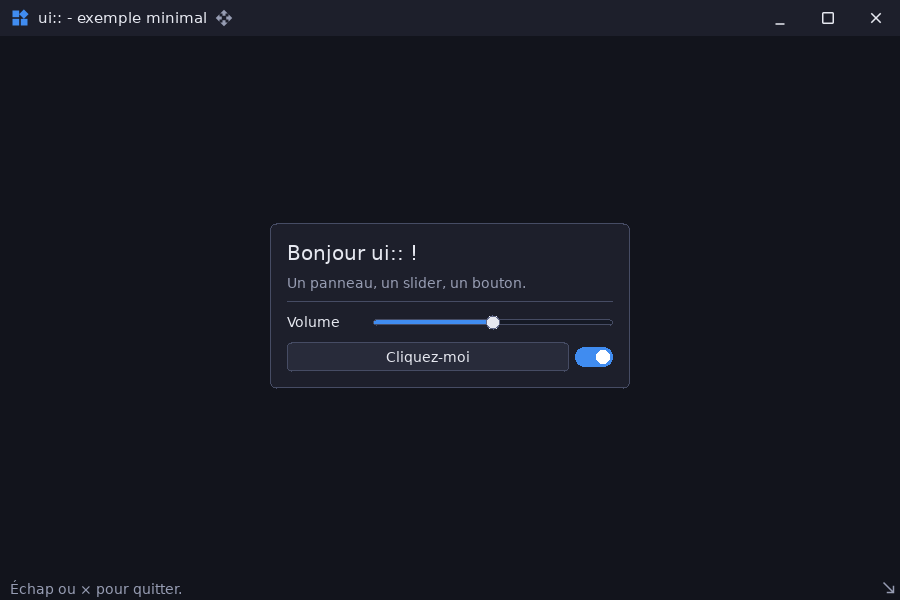

# ui_minimal — exemple minimal du module ui

`examples/ui_minimal` · exécutable `ui_minimal` · un seul fichier : [`src/main.cpp`](../examples/ui_minimal/src/main.cpp) (112 lignes)

> Exemple minimal du module ui

## Présentation

Le strict nécessaire pour une application [ui](libs_infrastructure_ui.md) :

- la façade `ui::Ui` et l'arbre déclaratif ;
- le cadre de fenêtre (`WindowFrame`) ;
- une carte centrée avec un curseur, un bouton et un interrupteur.

Les clics sont comptés dans la barre d'état.



## Modules utilisés

[`core`](libs_foundation_core.md), [`sdl3`](libs_infrastructure_sdl3.md), [`ui`](libs_infrastructure_ui.md)

## Lancer

```sh
cpp-maker run -m ui_minimal
```

Comme toutes les applications du dépôt, l'exemple se lance **depuis la
racine du dépôt** : polices, shaders et ressources sont lus dans `assets/`.
