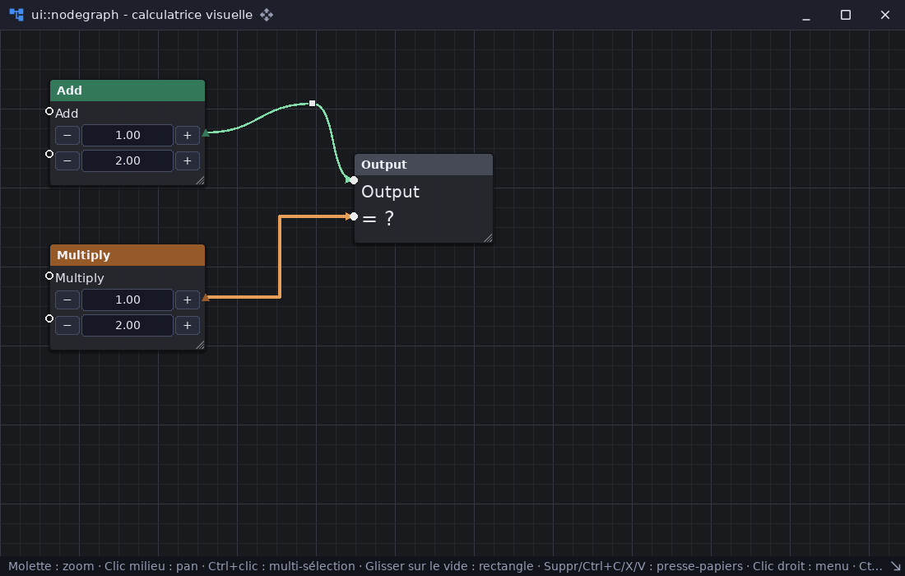

# ui_node_graph_demo — éditeur de graphes de nœuds

`examples/ui_node_graph_demo` · exécutable `ui_node_graph_demo` · un seul fichier : [`src/main.cpp`](../examples/ui_node_graph_demo/src/main.cpp) (201 lignes)

> Éditeur de node-graph (ui::nodegraph)

## Présentation

Une « calculatrice visuelle » façon Blueprint, sur `ui::nodegraph` : deux
nœuds d'opération (Add, Multiply) reliés à un nœud de sortie.

**Canevas et nœuds**

- grille de fond, déplacement (clic du milieu), zoom (molette vers le
  curseur) ;
- nœuds déplaçables et redimensionnables, sélection simple ou multiple
  (Ctrl), rectangle de sélection ;
- pins de formes variées.

**Connexions**

- Bézier ou orthogonales, avec flèches ;
- point intermédiaire par double clic sur le tracé.

**Édition et fichiers**

- couper, copier, coller, supprimer ; menu contextuel sur un nœud ;
- enregistrement et chargement en JSON (Ctrl+S, Ctrl+O).

Le contenu des nœuds est un arbre de widgets ordinaire, stylé en CSS.



## Modules utilisés

[`core`](libs_foundation_core.md), [`dataio`](libs_infrastructure_dataio.md), [`sdl3`](libs_infrastructure_sdl3.md), [`ui`](libs_infrastructure_ui.md)

## Lancer

```sh
cpp-maker run -m ui_node_graph_demo
```

Comme toutes les applications du dépôt, l'exemple se lance **depuis la
racine du dépôt** : polices, shaders et ressources sont lus dans `assets/`.
