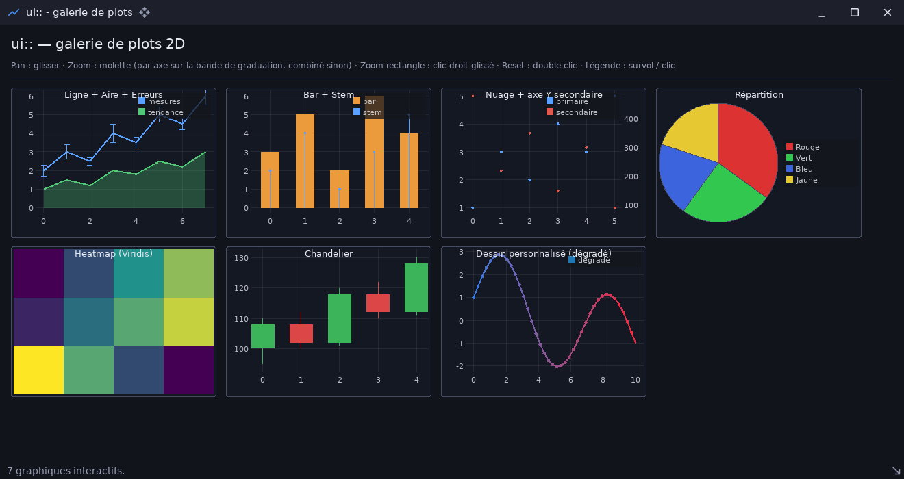

# ui_plot_demo — galerie des graphiques

`examples/ui_plot_demo` · exécutable `ui_plot_demo` · un seul fichier : [`src/main.cpp`](../examples/ui_plot_demo/src/main.cpp) (176 lignes)

> Galerie interactive des graphiques (ui::plot)

## Présentation

Un graphique par famille de `ui::plot` :

- courbe, aire et barres d'erreur ;
- barres et tiges ;
- nuage de points avec axe Y secondaire ;
- camembert, heatmap, chandeliers OHLC ;
- dessin personnalisé (dégradé par segment, via le `Painter`).

**Interactions** :

- glisser : déplacer la vue ;
- molette : zoom (par axe sur sa graduation, combiné ailleurs) ;
- clic droit glissé : zoom sur un rectangle ;
- double clic : ajustement automatique ;
- légende : surbrillance au survol, bascule de visibilité au clic.



## Modules utilisés

[`core`](libs_foundation_core.md), [`sdl3`](libs_infrastructure_sdl3.md), [`ui`](libs_infrastructure_ui.md)

## Lancer

```sh
cpp-maker run -m ui_plot_demo
```

Comme toutes les applications du dépôt, l'exemple se lance **depuis la
racine du dépôt** : polices, shaders et ressources sont lus dans `assets/`.
