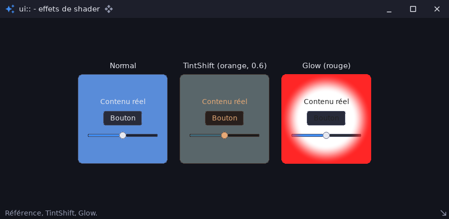

# ui_shader_effects_demo — effets de shader sur des widgets

`examples/ui_shader_effects_demo` · exécutable `ui_shader_effects_demo` · un seul fichier : [`src/main.cpp`](../examples/ui_shader_effects_demo/src/main.cpp) (115 lignes)

> Effets de shader sur les widgets (ui::UiShaderEffect)

## Présentation

Des panneaux 2D ordinaires (texte, bouton, curseur), chacun post-traité par
un effet GPU (`TINT_SHIFT`, `GLOW`) avec `ui::ShaderEffect`.

- Chaque sous-arbre est dessiné dans une texture, relu, envoyé au
  périphérique GPU du `render3d::Canvas`, filtré, puis affiché à sa place.
- Les widgets restent interactifs.
- Sans GPU, les panneaux sont dessinés normalement.



## Modules utilisés

[`core`](libs_foundation_core.md), [`sdl3`](libs_infrastructure_sdl3.md), [`render3d`](libs_infrastructure_render3d.md), [`ui`](libs_infrastructure_ui.md)

## Lancer

```sh
cpp-maker run -m ui_shader_effects_demo
```

Comme toutes les applications du dépôt, l'exemple se lance **depuis la
racine du dépôt** : polices, shaders et ressources sont lus dans `assets/`.
