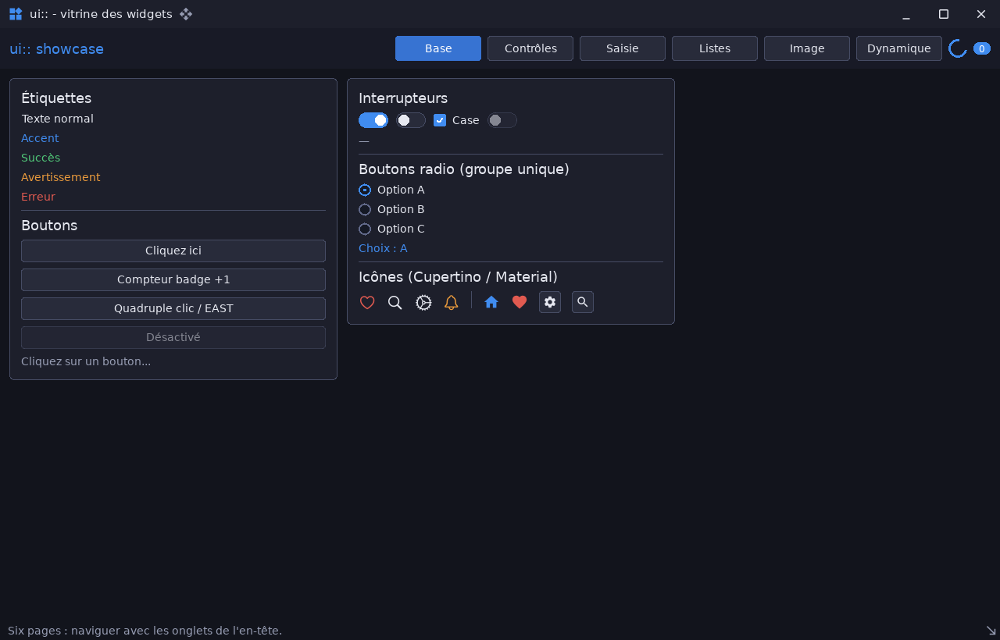

# ui_showcase — vitrine de tous les widgets

`examples/ui_showcase` · exécutable `ui_showcase` · un seul fichier : [`src/main.cpp`](../examples/ui_showcase/src/main.cpp) (577 lignes)

> Vitrine interactive de tous les widgets du module ui

## Présentation

Une barre d'onglets, et une page par famille de widgets. Changer de page ne
détruit rien : les pages sont gérées par `ui::SceneManager`.

| Page | Contenu |
|---|---|
| Base | Label, Button (et désactivé), Switch, Checkbox, Radio, Separator, Badge, icônes |
| Contrôles | Slider horizontal et vertical, Knob, Progress animé, Spinner |
| Saisie | Input, Password, TextArea, ScrollBar, ScrollView |
| Listes | Combo, ListBox, Expander, TabView |
| Image | Image (fill, contain, cover, none), Canvas animé |
| Dynamique | Styles en direct, visibilité, Splitter, menus, sélection, arbre, Table, graphe temps réel, couleurs, dates, modale, texte enrichi |



## Modules utilisés

[`core`](libs_foundation_core.md), [`sdl3`](libs_infrastructure_sdl3.md), [`ui`](libs_infrastructure_ui.md)

## Lancer

```sh
cpp-maker run -m ui_showcase
```

Comme toutes les applications du dépôt, l'exemple se lance **depuis la
racine du dépôt** : polices, shaders et ressources sont lus dans `assets/`.
