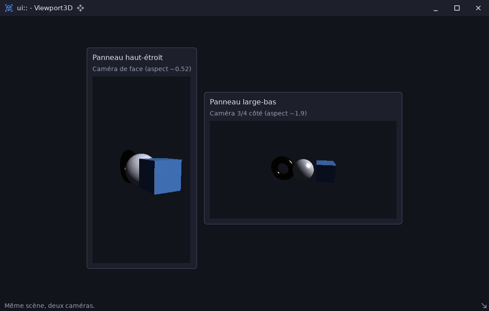

# ui_viewport3d_demo — scène 3D dans des widgets

`examples/ui_viewport3d_demo` · exécutable `ui_viewport3d_demo` · un seul fichier : [`src/main.cpp`](../examples/ui_viewport3d_demo/src/main.cpp) (295 lignes)

> Scène render3d intégrée dans un widget (ui::Viewport3D)

## Présentation

Deux `ui::Viewport3D` aux proportions très différentes (un panneau haut et
étroit, un panneau large et bas) montrent la **même** scène
[render3d](libs_infrastructure_render3d.md) depuis deux caméras. La
projection n'est jamais déformée.

L'exemple montre aussi le **préchauffage asynchrone des pipelines**. Un fil
secondaire force la compilation des shaders PBR (plusieurs centaines de
millisecondes) pendant que le fil principal affiche un écran de chargement.
La fenêtre ne gèle donc pas au démarrage.



## Modules utilisés

[`core`](libs_foundation_core.md), [`render3d`](libs_infrastructure_render3d.md), [`sdl3`](libs_infrastructure_sdl3.md), [`ui`](libs_infrastructure_ui.md)

## Lancer

```sh
cpp-maker run -m ui_viewport3d_demo
```

Comme toutes les applications du dépôt, l'exemple se lance **depuis la
racine du dépôt** : polices, shaders et ressources sont lus dans `assets/`.
