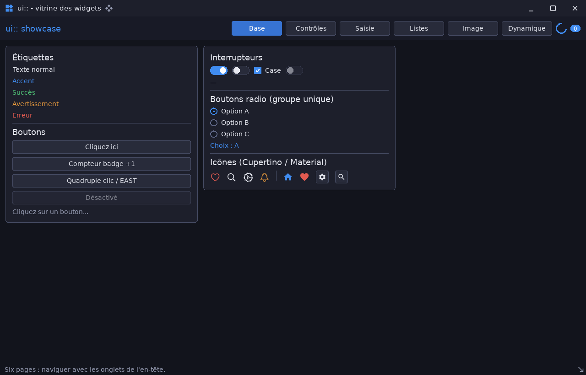
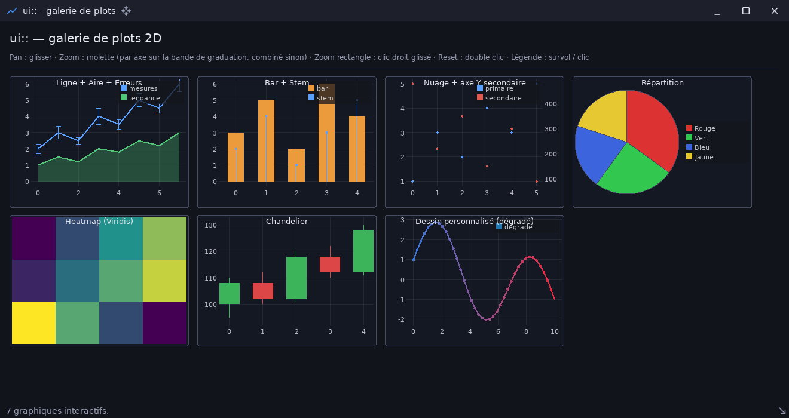
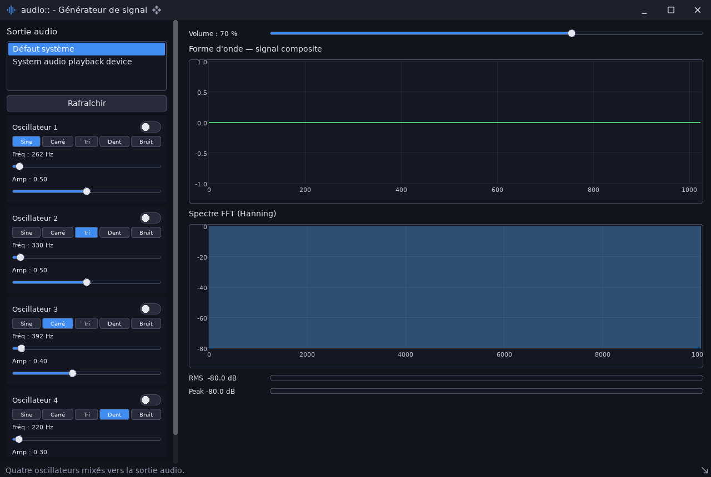
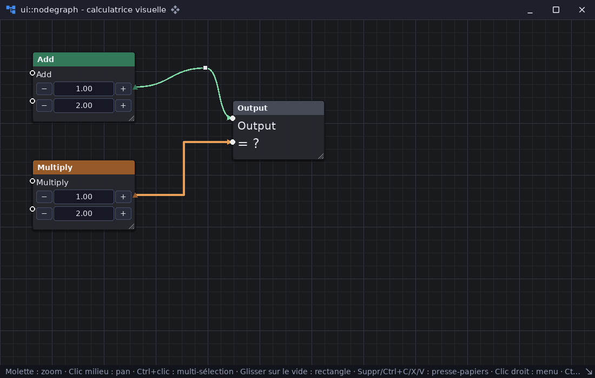
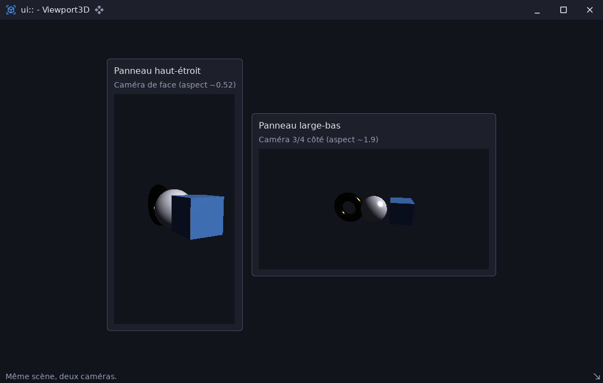
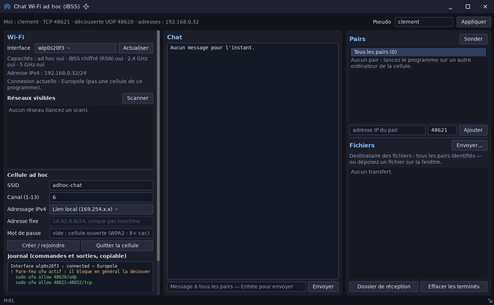

# Exemples

Le dossier `examples/` contient **18 exemples**. Chacun est un module
exécutable d'un seul fichier, `examples/<nom>/src/main.cpp`. Ils montrent
l'utilisation d'un module ou d'une fonction précise, du plus simple
(`ui_minimal`, `render3d_cube`) au plus complet (`ui_showcase`,
`audio_patchbay`).

```sh
cpp-maker run -m <nom>                  # compile (debug) puis lance
cpp-maker run release -m <nom>          # version optimisée
cpp-maker run -m <nom> -- --option      # arguments transmis au programme
```

> Le nom de l'exemple se donne avec **`-m`**. `cpp-maker run ui_minimal`
> échoue (« mode inconnu »), car l'argument positionnel de `run` est le mode
> de compilation. Les commentaires d'en-tête de certains exemples utilisent
> encore l'ancienne forme. Lancez les exemples **depuis la racine du dépôt**.

## Plate-forme et rendu 2D

| Exemple | Ce qu'il montre |
|---|---|
| [platform_app](example_platform_app.md) | Application minimale sur `platform::Application` : pas fixe, bus d'évènements, diagnostics |
| [renderer](example_renderer.md) | Rendu 2D `sdl3::Renderer` : formes, textures, texte, évènements |

## Interface (`ui`)

| Exemple | Ce qu'il montre |
|---|---|
| [ui_minimal](example_ui_minimal.md) | Le strict nécessaire : `ui::Ui`, builders, `WindowFrame` |
| [ui_showcase](example_ui_showcase.md) | Tous les widgets, une page par famille |
| [ui_aero_basics](example_ui_aero_basics.md) | Thème Frutiger Aero : widgets de base, sélecteur de couleur |
| [ui_aero_lists](example_ui_aero_lists.md) | Thème Frutiger Aero : listes, arbres, tableaux |
| [ui_aero_windows](example_ui_aero_windows.md) | Thème Frutiger Aero : bureau, fenêtres internes, menus, modale |
| [ui_node_graph_demo](example_ui_node_graph_demo.md) | Éditeur de graphes de nœuds façon Blueprint |
| [ui_plot_demo](example_ui_plot_demo.md) | Galerie des graphiques façon ImPlot |
| [ui_shader_effects_demo](example_ui_shader_effects_demo.md) | Effets GPU appliqués à des sous-arbres de widgets |
| [ui_viewport3d_demo](example_ui_viewport3d_demo.md) | Scène 3D intégrée dans des widgets, préchauffage des pipelines |

## Rendu 3D (`render3d`)

| Exemple | Ce qu'il montre |
|---|---|
| [render3d_cube](example_render3d_cube.md) | Premier rendu de bout en bout : `Canvas`, cube, lumières |
| [render3d_showcase](example_render3d_showcase.md) | Hiérarchie d'objets, géométries, PBR, lumières ponctuelles et projecteur |
| [render3d_shadows_ibl_showcase](example_render3d_shadows_ibl_showcase.md) | Ombres, éclairage par image (IBL), points, sprites, instances, squelettes, LOD (demande un fichier `.hdr` absent du dépôt) |

## Audio (`audio`)

| Exemple | Ce qu'il montre |
|---|---|
| [audio_signal_generator](example_audio_signal_generator.md) | Quatre oscillateurs, forme d'onde, spectre, VU-mètres |
| [audio_spectrum_analyzer](example_audio_spectrum_analyzer.md) | Analyse de spectre en temps réel d'un micro |
| [audio_patchbay](example_audio_patchbay.md) | Routage audio par graphe de nœuds (filtres, mélangeur, délai, lecteur) |

## Réseau (`net`)

| Exemple | Ce qu'il montre |
|---|---|
| [adhoc_chat_demo](example_adhoc_chat_demo.md) | Chat et transfert de fichiers sur un réseau local ou une cellule Wi-Fi ad hoc |

| | | |
|---|---|---|
|  |  |  |
|  |  |  |
