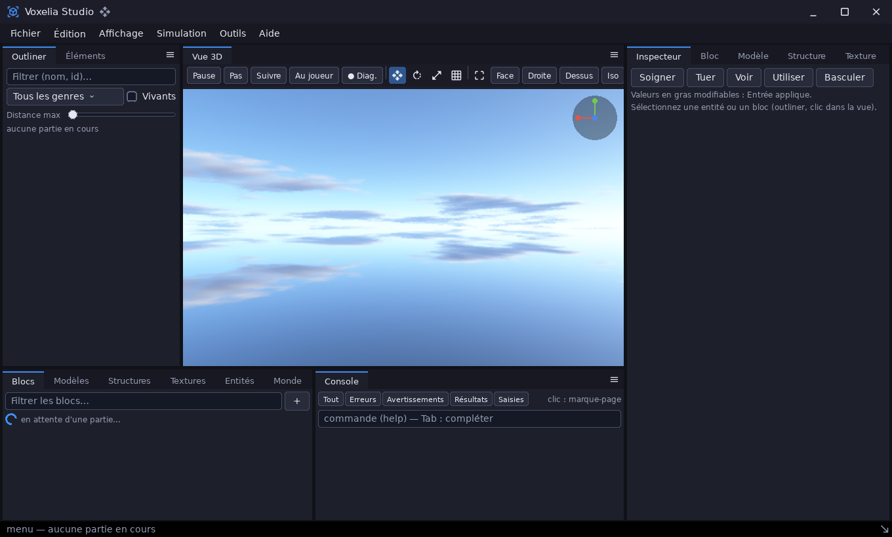

# editor — briques communes des éditeurs 3D

`libs/infrastructure/editor` · couche **infrastructure** · `libeditor.a` · espace de noms `editor::`

## Présentation

`editor` rassemble ce que partagent les éditeurs 3D du dépôt : la
[sandbox](demo_sandbox.md) et Voxelia Studio ([voxelia](demo_voxelia.md)).
Le [profiler](demo_profiler.md) en utilise aussi le thème et les docks.

| Brique | Rôle |
|---|---|
| Thème du cadre | Palette dérivée du thème `ui::` actif (rien n'est codé en dur), feuille `.editor-*` / `.dock-*`, boutons d'icône plats, champ de recherche, poignées de redimensionnement |
| `DockPanel` | Panneau à onglets (fermables ou non), boutons de bandeau, menu ≡, pages empilées |
| `OrbitNavigator` | Caméra d'éditeur autour d'un pivot : orbite, orbite autour du point visé, panoramique qui garde le point sous le curseur, zoom vers le curseur, cadrage d'une boîte, vues normalisées, vol libre |
| `TransformGizmo` | Gizmo de déplacement, rotation et échelle, de taille constante à l'écran, avec saisie en pixels et accroches |
| `CommandPalette` / `CommandPaletteView` | Palette de commandes à recherche floue, les commandes récentes d'abord |

La navigation, le gizmo et la palette sont du **calcul pur**, sans fenêtre :
les tests les pilotent en pixels.



## Architecture interne

| Fichier | Contenu |
|---|---|
| `editor.hpp` | En-tête parapluie |
| `theme.hpp`, `src/theme.cpp` | `AXIS_X/Y/Z`, `HIGHLIGHT`, `Rgb`, `Mix`, `Luminance`, `Palette`, `PaletteOf`, `EditorCss`, `Readable`, `SetHidden`, `IconButton`, `SearchField`, `ResizeHandle` ; le corps de `DockPanel` |
| `dock.hpp` | `DockPanel` |
| `navigation.hpp`, `src/navigation.cpp` | `ViewPreset`, `OrbitNavigator` |
| `gizmo.hpp`, `src/gizmo.cpp` | `GizmoMode`, `GizmoHandle`, `GizmoDelta`, `GizmoStroke`, `GizmoView`, `TransformGizmo` |
| `command_palette.hpp`, `src/command_palette.cpp` | `PaletteEntry`, `FuzzyScore`, `CommandPalette`, `CommandPaletteView` |

Dépendances : `core`, `math`, `sdl3`, `ecs`, `render3d` (`Camera`), `ui`.

## API publique

### `OrbitNavigator`

**Champs** : `pivot`, `distance`, `yaw`, `pitch` (borné à ±89°), `fovY`,
`minDistance`, `maxDistance`.

**Calculs** : `Forward`, `Right`, `Up`, `Eye`, `ToCamera(aspect, near, far)`,
`WorldPerPixel(hauteur)`.

**Gestes** :

- `Orbit(dx, dy)` et `OrbitAbout(point, dx, dy)` ;
- `Pan(dx, dy, hauteur)` ;
- `Dolly(crans, versPoint)` : zoom vers le point sous le curseur ;
- `Frame(min, max, aspect)` : cadre une boîte ;
- `SetView(ViewPreset)` : `Front`, `Back`, `Left`, `Right`, `Top`, `Bottom`
  ou `Iso` ;
- `Fly(avant, droite, haut)` : vol libre ;
- `LookFrom(œil, cible)`.

### `TransformGizmo`

**Réglages**

- `mode` : `Translate`, `Rotate` ou `Scale` ;
- `position`, `sizePixels`, `pickRadius`, `visible` ;
- accroches : `translateSnap`, `rotateSnap` et `scaleSnap` (0 = libre).

**Saisie et glissé**

- `Pick(view, x, y)` et `Hover(view, x, y)` rendent une `GizmoHandle` :
  axe `X`, `Y`, `Z` ; plan `XY`, `YZ`, `ZX` ; centre `All`.
- `Begin(view, x, y)` démarre un glissé, puis `Drag(view, x, y)` le suit et
  `End()` le termine.
- `Drag` rend la transformation **totale** depuis `Begin` (`GizmoDelta` :
  `translation`, `rotationAxis` et `angle`, `scale`), jamais un incrément.
  L'appelant l'applique à l'état mémorisé au `Begin`, ce qui ne fait qu'une
  étape d'annulation.

**Dessin**

- `Strokes(view)` rend les segments à tracer, en pixels, par-dessus le rendu
  3D.
- `GizmoView {camera, width, height}` décrit la vue.

### `CommandPalette`

- `Add(PaletteEntry {id, title, help, shortcut, run})`.
- `Search(requête, limite)` rend les indices des entrées, de la meilleure à
  la moins bonne.
- `Run(index)` exécute l'entrée et la note comme récente ; `Recent()` liste
  ces entrées.
- `FuzzyScore(requête, texte)` cherche une sous-séquence, avec un bonus aux
  débuts de mots et aux lettres consécutives.
- **`CommandPaletteView(gui, model)`** est la vue modale :
  - `Build(parent)`, `Open`, `Close`, `SetQuery` ;
  - `Move(±1)` et `Accept()` ;
  - clavier : ↑ et ↓ choisissent, Entrée exécute, Échap ferme.

### `DockPanel`

- `Build(parent, dimensionner)` crée le panneau.
- `AddPage(titre, défilable, fermable)` rend le conteneur de la page.
- `RemovePage`, `SetActive`, `SetTitle`, `Find`, `Page`, `HeaderExtra()` :
  la zone des boutons à droite des onglets.
- Rappels : `onActivate`, `onClose`, `onMenu`.

### Thème et briques

- `PaletteOf(ui::Palette)` rend `editor::Palette` : `base`, `header`,
  `toolbar`, `well`, `selection`, `separator`, `ok`, `warning`, `error`,
  `light`.
- `EditorCss(theme)` produit la feuille de l'éditeur, à ajouter avec
  `gui.AddStyleSheet`.
- Briques :
  - `IconButton(theme, parent, icône, info-bulle, action)` ;
  - `SearchField(theme, parent, invite, onChange)` ;
  - `ResizeHandle(theme, parent, orientation, cible, avant, min, max)`.

## Exemple

```cpp
#include <cstdio>
#include <editor/editor.hpp>

int main() {
	// ── Caméra d'éditeur autour d'un pivot ──
	editor::OrbitNavigator nav;
	nav.SetView(editor::ViewPreset::Iso);
	nav.Frame({-1.f, 0.f, -1.f}, {1.f, 2.f, 1.f}, 16.f / 9.f); // « zoom étendu » sur une boîte
	nav.Orbit(120.f, -40.f);                                    // glissé de la souris, en pixels
	nav.Dolly(2.f);                                             // deux crans de molette
	render3d::Camera camera = nav.ToCamera(16.f / 9.f);
	std::printf("œil (%.2f, %.2f, %.2f), distance %.2f\n", camera.position.x, camera.position.y, camera.position.z, nav.distance);

	// ── Gizmo : glisser la flèche X de 100 px, avec un pas de grille de 0,5 ──
	editor::TransformGizmo gizmo;
	gizmo.translateSnap = 0.5f;
	editor::GizmoView view{camera, 1280.f, 720.f};
	std::printf("%zu segments à dessiner\n", gizmo.Strokes(view).size());
	for (float y = 0.f; y < view.height; y += 2.f)        // cherche un pixel de la flèche X
		for (float x = 0.f; x < view.width; x += 2.f)
			if (gizmo.Pick(view, x, y) == editor::GizmoHandle::X && gizmo.Begin(view, x, y)) {
				editor::GizmoDelta d = gizmo.Drag(view, x + 100.f, y); // total depuis Begin
				std::printf("translation (%.2f, %.2f, %.2f)\n", d.translation.x, d.translation.y, d.translation.z);
				gizmo.End();
				y = view.height; // sortie des deux boucles
				break;
			}

	// ── Palette de commandes : recherche floue ──
	editor::CommandPalette palette;
	palette.Add({.id = "file.save", .title = "Enregistrer le projet", .shortcut = "Ctrl+S", .run = [] { std::printf("→ enregistré\n"); }});
	palette.Add({.id = "view.top", .title = "Vue de dessus", .shortcut = "7"});
	palette.Add({.id = "gizmo.rotate", .title = "Gizmo : rotation", .shortcut = "R"});
	std::vector<size_t> hits = palette.Search("enrg");
	if (!hits.empty()) {
		std::printf("« enrg » → %s\n", palette.Entry(hits[0]).title.CStr());
		palette.Run(hits[0]);
	}
	return 0;
}
```

Sortie :

```
œil (-0.44, 1.77, 2.48), distance 2.63
25 segments à dessiner
translation (0.50, 0.00, 0.00)
« enrg » → Enregistrer le projet
→ enregistré
```

Le glissé de 100 px sur la flèche X donne 0,50 : la translation est accrochée
au pas de 0,5.

## Intégration

`modules = ["editor"]`. Dans une interface `ui::` :

1. `gui.AddStyleSheet(editor::EditorCss(gui.CurrentPalette()))` ;
2. construisez des `DockPanel` pour les zones de l'éditeur ;
3. branchez une `ui::Viewport3D` marquée `.AppSurface()` sur un
   `OrbitNavigator` et un `TransformGizmo`, dont les traits se dessinent par
   le `Painter`.

Voir `demos/sandbox/src/editor/` et `demos/voxelia/src/studio/` pour une
intégration complète.

## Tests

```sh
cpp-maker test -m editor
```

Les 11 tests couvrent la navigation, le gizmo (saisie, accroches, total
depuis `Begin`), la recherche floue et la palette.
