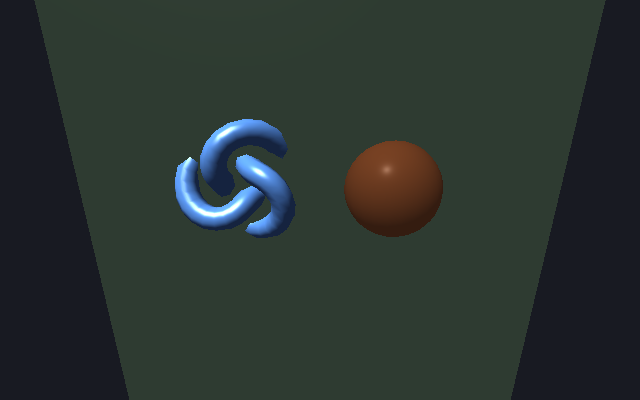

# render3d — rendu 3D sur SDL_GPU

`libs/infrastructure/render3d` · couche **infrastructure** · `librender3d.a` · espace de noms `render3d::`

## Présentation

`render3d` est un moteur de rendu 3D (et 2D) bâti sur l'API GPU de SDL3
(`sdl3::Gpu*`). Son organisation s'inspire de three.js : un graphe de
`Object3D`, des maillages, des matériaux, des lumières et une caméra.

| Domaine | Contenu |
|---|---|
| Rendu | `Canvas` : périphérique GPU, pipelines mis en cache, passes de rendu, élimination hors champ, superposition 2D |
| Scène | `Object3D` (hiérarchie, TRS, visibilité, nom), `Shape` (maillage + matériaux), `Sprite`, `LOD`, `Points`, `LineSegments`, `InstancedMesh` |
| Géométrie | `Mesh` : boîte, sphère, plan, cylindre, cône, tore, nœud torique, polyèdres, tube, tour (*lathe*), extrusion de `Shape2D`, points, segments ; `PrimitiveSpec` (identité canonique d'une primitive) ; courbes |
| Matériaux | `Material` : Plastic, Metal, Wood, Unlit, Pbr ; Phong ou PBR ; topologie ; textures |
| Lumières | `DirectionalLight`, `AmbientLight`, `PointLight`, `SpotLight` ; ombres directionnelles et projetées (*shadow maps*) |
| Environnement | Chargeur Radiance `.hdr` écrit à la main, cubemap depuis une image équirectangulaire, irradiance, spéculaire préfiltré, BRDF LUT (IBL complet), *skybox* |
| Animation | `KeyframeTrack`, `AnimationClip`, `AnimationMixer` (n'importe quel `Object3D` par son nom) ; `SkinnedMesh`, `Bone`, `SkinnedGeometry` |
| Shaders | Shaders précompilés (`assets/shaders/bin`) ; `ShaderBuilder`, qui compose du GLSL à partir de `shader_chunks` et le compile à l'exécution (GLSL → SPIR-V par shaderc → MSL par SPIRV-Cross) ; modèles d'éclairage `UNLIT`, `PHONG`, `PBR` et `BAKED` (lumière par sommet, pour les moteurs voxel) |
| Hors écran | `OffscreenTarget`, `RenderObjectToTexture` (GPU → CPU), `UploadSurfaceToGpuTexture` (CPU → GPU) ; c'est la base de `ui::Viewport3D` |
| Outils | `PickMeshFace` (rayon contre faces), portails à plan proche oblique (`Portal`, `RenderPortalRecursive`), réflexions dans une grille de voxels (`VoxelReflections`) |
| Ressources | `MeshResource`, `TextureResource`, `MaterialResource`, `ShaderResource` pour le `ResourceCache` (`RegisterResourceFactories`) |
| Pont ECS | `SceneTransform`, `SceneNode`, `SceneParent`, `SceneSyncSystem::Sync` : ECS → `Object3D`, à sens unique |

**Convention** : les projections visent l'espace de découpe Vulkan (Y vers le
bas, Z ∈ [0, 1]). La caméra par défaut est en `z = -5` et regarde vers `+z`.

**Utilisateurs** :

- [`ui`](libs_infrastructure_ui.md) : `Viewport3D` et les effets de shader ;
- [`editor`](libs_infrastructure_editor.md) ;
- la [sandbox](demo_sandbox.md), [voxelia](demo_voxelia.md) et le
  [profiler](demo_profiler.md) ;
- les exemples `render3d_*` et `ui_viewport3d_demo`.

## Architecture interne

| En-tête | Rôle |
|---|---|
| `canvas.hpp` | `Canvas` (point d'entrée), `OffscreenSync`, `VoxelReflections` |
| `object3d.hpp`, `shape.hpp`, `sprite.hpp`, `lod.hpp`, `point_line.hpp`, `instanced_mesh.hpp` | Nœuds de la scène |
| `mesh.hpp`, `vertex.hpp`, `curve.hpp`, `shape2d.hpp` | Géométrie (`Vertex3D` : position, normale, uv, couleur UBYTE4_NORM, lumière précalculée) |
| `material.hpp` | `Material`, `ShaderKind`, `PipelineKey`, `PrimitiveTopology` |
| `light.hpp`, `shadow.hpp` | Lumières, résolution et matrices des ombres |
| `camera.hpp` | `Camera` (`position`, `target`, `up`, `fovYRadians`, `aspect`, `nearPlane`, `farPlane`, `ScreenPointToRay`, `ClipObliqueNearPlane`) |
| `environment.hpp`, `cubemap.hpp`, `brdf_lut.hpp`, `hdr_loader.hpp` | IBL et ciel |
| `animation.hpp`, `skinned_mesh.hpp`, `skinned_geometry.hpp` | Animation |
| `shader_builder.hpp`, `shader_chunks.hpp`, `shader_compiler.hpp`, `shader_program.hpp` | Shaders |
| `texture_loader.hpp` | Fichier image → `sdl3::GpuTexture` (RGBA32) |
| `offscreen.hpp`, `picking.hpp`, `portal.hpp` | Rendu hors écran, sélection, portails |
| `resources.hpp` | Ressources de rendu |
| `ecs_bridge.hpp` | Pont ECS |

Dépendances internes : `core`, `diagnostics` (zones de capture), `math`,
`sdl3`, `ecs`, `dataio` (glTF) et `resources`.

Dépendances externes :

- `shaderc` (pkg-config) ;
- `spirv-cross-msl`, `spirv-cross-glsl`, `spirv-cross-core` et
  `spirv-cross-util` (bibliothèques système).

Les shaders sources (`assets/shaders/src/*.vert|frag`) sont compilés en
`assets/shaders/bin/*.spv` et `*.msl` par l'étape `[generate.shaders]` de
cpp-maker (voir [compilation](compilation.md#shaders)).

## API publique : `Canvas`

| Membre | Rôle |
|---|---|
| `static Create(sdl3::Window&, w, h)` | Crée son propre périphérique GPU sur la fenêtre (Vulkan/SPIR-V, Metal/MSL) |
| `static Create(sdl3::Renderer&, w, h)` | Partage le périphérique d'un `Renderer` 2D adossé au GPU (UI 2D et 3D sur la même fenêtre) |
| `SetCamera`, `SetBackgroundColor`, `SetExposure`, `SetBaseLight` | Réglages de l'image |
| `SetLighting(directionnelle, ambiante)`, `SetLights(ponctuelles, projecteurs)` | Éclairage |
| `SetEnvironment(env)` / `ClearEnvironment`, `SetSkybox` / `ClearSkybox`, `SetSkyboxTint` | IBL et ciel |
| `SetFrustumCullingEnabled`, `IsPotentiallyVisible(mesh, transform)` | Élimination hors champ |
| `bool Begin()` … `End()` | Une image ; `Begin` rend faux si l'image doit être sautée (fenêtre réduite…) |
| `DrawMesh(mesh, transform, material)`, `DrawMeshGroup`, `DrawInstancedMesh`, `DrawSkinnedMesh`, `DrawObject(racine)` | Dessin |
| `RenderObjectOffscreen(...)` | Rendu d'un sous-arbre dans une cible hors écran |
| `SetOverlay(pixels, w, h, pitch, …)` | Image 2D composée par-dessus la 3D (encadrement de fenêtre) |
| `SetVoxelReflections(...)` | Réflexions par lancer de rayons dans une grille de voxels |
| `Device()` | Le `sdl3::GpuDevice` |

Le `Canvas` doit être **détruit avant `SDL_Quit`**. Placez-le dans une portée
imbriquée, sous le `SdlContext`.

## Exemple : scène rendue hors écran

```cpp
#include <cstdio>
#include <render3d/canvas.hpp>
#include <render3d/light.hpp>
#include <render3d/offscreen.hpp>
#include <render3d/shape.hpp>
#include <sdl3/sdl3.hpp>

int main() {
	auto sdl = sdl3::SdlContext::Create(sdl3::init_flags::VIDEO);
	auto win = sdl3::Window::Create("render3d", 640, 400, sdl3::window_flags::HIDDEN);
	if (!sdl || !win)
		return 1;
	{ // le Canvas doit être détruit avant SDL_Quit
		auto created = render3d::Canvas::Create(win.Value(), 640, 400);
		if (!created) {
			std::printf("Canvas : %s\n", String(created.Error()).CStr());
			return 1;
		}
		render3d::Canvas canvas = std::move(created.Value());

		// Graphe de scène : une racine, un sol et deux objets
		render3d::Object3D root;
		auto ground = std::make_unique<render3d::Shape>(render3d::Mesh::Plane(8.f, 8.f),
														std::vector{render3d::Material::Plastic(sdl3::Color{70, 90, 70})});
		ground->SetRotation(math::FQuaternion::FromAxisAngle({1, 0, 0}, -1.5707963f));
		root.Add(std::move(ground));
		auto ball = std::make_unique<render3d::Shape>(render3d::Mesh::Sphere(0.8f),
													  std::vector{render3d::Material::Pbr(sdl3::Color{220, 120, 60}, 0.f, 0.35f)});
		ball->SetPosition({-1.2f, 0.8f, 0.f});
		root.Add(std::move(ball));
		auto knot = std::make_unique<render3d::Shape>(render3d::Mesh::TorusKnot(0.6f, 0.2f),
													  std::vector{render3d::Material::Metal(sdl3::Color{90, 150, 230})});
		knot->SetPosition({1.3f, 0.9f, 0.f});
		root.Add(std::move(knot));

		render3d::Camera camera;
		camera.position = {0.f, 2.5f, -5.5f};
		camera.target = {0.f, 0.6f, 0.f};
		render3d::DirectionalLight sun;
		sun.direction = {-0.4f, -1.f, 0.5f};
		render3d::AmbientLight ambient;
		ambient.color = sdl3::Color{60, 60, 70};
		canvas.SetLighting(sun, ambient);
		canvas.SetBackgroundColor(sdl3::Color{24, 26, 34});

		// À l'écran : canvas.SetCamera(camera); if (canvas.Begin()) { canvas.DrawObject(root); canvas.End(); }
		// Hors écran : rendu dans une texture puis lecture des pixels (RGBA)
		render3d::OffscreenTarget target;
		auto sized = target.EnsureSize(canvas.Device(), 640, 400, SDL_GPU_TEXTUREFORMAT_R8G8B8A8_UNORM,
									   SDL_GPU_TEXTUREFORMAT_D32_FLOAT);
		if (!sized)
			return 1;
		std::vector<uint8_t> pixels;
		auto rendered = render3d::RenderObjectToTexture(canvas, root, camera, target, pixels);
		if (!rendered) {
			std::printf("rendu : %s\n", String(rendered.Error()).CStr());
			return 1;
		}
		auto surface = sdl3::Surface::CreateFromPixels(640, 400, sdl3::PixelFormat::RGBA32, pixels.data(), 640 * 4);
		if (surface)
			(void)sdl3::ImgSavePng(surface.Value(), "scene.png");
		std::printf("%zu octets rendus\n", pixels.size());
	}
	return 0;
}
```



Pour le rendu à l'écran, la boucle de
[`examples/render3d_cube`](../examples/render3d_cube/src/main.cpp) suffit :

```cpp
canvas.SetCamera(camera);
canvas.SetLighting(sun, ambient);
while (running) {
	// … évènements …
	if (canvas.Begin()) {
		canvas.DrawMesh(cube, math::FMatrix4::RotateY(angle), material);
		canvas.End();
	}
}
```

## Intégration

`modules = ["render3d"]`.

- Il faut un périphérique compatible SDL_GPU : Vulkan sous Linux et Windows,
  Metal sous macOS.
- Sans GPU (CI, machine distante), les tests concernés appellent `SKIP`.
- Pour les ressources partagées, appelez
  `render3d::RegisterResourceFactories(cache)`, puis désignez maillages et
  matériaux par `AssetRef` (voir [resources](libs_infrastructure_resources.md)).
- Pour une scène pilotée par l'ECS :
  - ajoutez `SceneTransform` et `SceneNode` aux entités ;
  - appelez `SceneSyncSystem::Sync(world, racine)` à chaque image.

## Tests

```sh
cpp-maker test -m render3d
```

Les tests couvrent :

- l'animation, le pont ECS, l'environnement et le chargeur HDR ;
- le rendu hors écran et le picking ;
- les portails et leur rendu ;
- l'orientation des primitives ;
- le `ShaderBuilder`, le compilateur de shaders et les ombres.

Un test est ignoré sans GPU.
