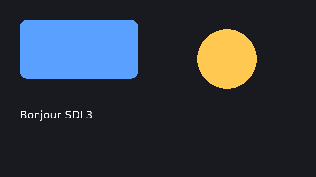

# sdl3 — wrapper C++ de SDL3 et de ses extensions

`libs/infrastructure/sdl3` · couche **infrastructure** · `libsdl3.a` · espace de noms `sdl3::`

## Présentation

`sdl3` est le wrapper C++23 de SDL3 et de ses bibliothèques compagnes :
SDL3_ttf, SDL3_image, SDL3_mixer et SDL3_net. C'est le **seul** module qui
déclare les paquets SDL dans `pkg_config`. Tous les autres y accèdent à
travers lui.

Il couvre :

- les fenêtres et le rendu 2D (`Renderer`, `Texture`, `Surface`) ;
- l'API GPU de SDL (`GpuDevice`…), OpenGL et Vulkan ;
- les évènements et les entrées (clavier, souris, manettes, joysticks,
  tactile, stylet) ;
- l'audio, le mixeur, les polices et les images ;
- le réseau TCP et UDP ;
- les fils et la synchronisation ;
- le temps et les minuteries ;
- les flux d'E/S, les fichiers, le stockage, les processus et les dialogues
  natifs ;
- les capteurs, caméras, retour haptique, HID, MIDI et DMX ;
- l'icône de la zone de notification, les propriétés et le presse-papiers.

### Principes de conception

- **Aucun pointeur C brut dans les signatures publiques.**
  - Les ressources possédées dérivent de `Wrapper<T, Deleter>` (RAII,
    déplaçable, non copiable).
  - Les ressources empruntées dérivent de `Borrowed<T>`.
  - Les structures C sont recopiées dans des structures C++ à champs nommés
    (`Point`, `FRect`, `CameraSpec`, `PathInfo`…).
  - Les paramètres de sortie deviennent des types de retour.
  - Exception admise : les `const char*` en lecture seule, comme les noms.
- **Aucune exception.** Les fabriques rendent `Result<T, Error>` ou
  `Result<T, StringView>`, et l'erreur porte le message de `SDL_GetError()`.
- Les constantes SDL sont regroupées dans de petits espaces de noms :
  `sdl3::init_flags::VIDEO`, `sdl3::window_flags::RESIZABLE`,
  `sdl3::gpu_texture_usage::…`, etc.

Ce module est compilé avec `-Werror -Wsign-compare` : voir
[compilation.md](compilation.md).

## Architecture interne

L'en-tête parapluie `include/sdl3/sdl3.hpp` inclut tous les autres. Chaque
en-tête a son `.cpp` dans `src/`.

| En-tête | Contenu principal |
|---|---|
| `sdl_context.hpp` | `SdlContext` : `SDL_Init`/`SDL_Quit` en RAII, `init_flags::` |
| `error.hpp` | `GetError`, `SetError`, `ClearError` |
| `stdinc.hpp` | Enveloppes de `SDL_stdinc.h` : `memory::`, `ctype::`, `env::`, fonctions mathématiques |
| `structs.hpp` | `Color` (8 bits) et `FColor` (flottant), avec une centaine de couleurs nommées (`Color::RED()`…) ; `Point`, `FPoint`, `Rect`, `FRect`, `Vertex`, `BlendMode`, `FlipMode` ; alias `Corners`/`Sides` de `math::` |
| `render.hpp` | `Window`, `Surface`, `Texture`, `Renderer`, `PixelFormat`, `TextureAccess`, `window_flags::` |
| `events.hpp` | `Event` (prédicats typés), `EventType`, `EventWatch`, `PollEvent`, `WaitEvent`, `PushEvent`, `PushUserEvent` |
| `input.hpp` | `Key`, `Keymod`, `MouseButton`, `MouseState`, `Cursor`, `SystemCursor`, `Gamepad` et ses énumérations ; gestes de bouton (`ButtonInput`, `ButtonGesture`, `ButtonGestureTracker`) ; fonctions `keyboard::` et `mouse::` |
| `joystick.hpp`, `haptic.hpp`, `touch.hpp`, `pen.hpp`, `sensor.hpp` | Joysticks bruts, retour de force, doigts, stylet, accéléromètre et gyroscope |
| `audio.hpp` | `AudioDevice`, `AudioSpec`, `AudioStream`, `WavData` |
| `mixer.hpp` | `MixerContext`, `Mixer`, `MixAudio`, `MixTrack`, `AudioDecoder` (décodage PCM à la demande, pour alimenter un graphe DSP) |
| `ttf.hpp` | `TtfContext`, `Font` (`Open`, `FindLocal`, `Measure`, `Render*`, `RenderTexture`), `TextEngine`, `Text` |
| `image.hpp` | `ImgLoad*`, `ImgLoadTexture*`, `ImgSavePng`, `ImgSaveJpg` |
| `gpu.hpp` | `GpuDevice`, `GpuBuffer`, `GpuTransferBuffer`, `GpuTexture`, `GpuSampler`, `GpuShader`, `GpuGraphicsPipeline`, `GpuComputePipeline`, `GpuCommandBuffer`, `GpuRenderPass`, `GpuCopyPass`, `GpuComputePass`, `GpuFence` ; constantes `gpu_*::` |
| `gl.hpp`, `vulkan.hpp` | `GlContext` avec les aides `gl::` ; `VkLibrary` avec les aides `vulkan::` |
| `iostream.hpp` | `IOStream` (possédant), `IOStreamView` (emprunté), `IOStatus`, `ReadFile`, `WriteFile` |
| `filesystem.hpp`, `storage.hpp` | Chemins (`filesystem::`), `Folder`, glob ; `Storage` (titre, utilisateur, disque) et `PathInfo` |
| `process.hpp` | `Process` (lancement, redirection stdio), `ProcessOutput` |
| `dialog.hpp` | Dialogues natifs d'ouverture et d'enregistrement, asynchrones (`DialogFilter`, `DialogResult`) |
| `misc.hpp` | `Properties` (accès typé `props["clé"]`), `PropertiesRef`, `PropertiesLock`, boîtes de message, `clipboard::`, `system::` |
| `thread.hpp` | `Thread`, `Mutex` et `MutexGuard`, `RWLock`, `Semaphore`, `Condition`, `SpinLock`, `AtomicInt`, `AtomicU32`, `ForeignThreadScope` |
| `time.hpp` | `GetTicksMS/NS`, `Delay*`, `DateTime`, `Timer`, `Stopwatch`, `FrameTimestep` (pas de temps et image/s mesurées) |
| `log.hpp` | `LogPriority`, `LogCategory`, `LogRouter` (diffuse `SDL_Log` vers plusieurs sinks C++), `FileLogSink` (écriture dans un fil dédié) |
| `net.hpp` | `NetContext`, `IpAddress` (à compteur de références, résolution), `TcpSocket`, `TcpServer`, `UdpSocket`, `ReceivedDatagram` |
| `camera.hpp` | `Camera`, `CameraSpec`, `CameraFrame` |
| `hidapi.hpp`, `midi.hpp`, `dmx.hpp` | HID USB/Bluetooth brut ; messages MIDI et `MidiParser`, indépendants du transport ; univers DMX512 |
| `tray.hpp`, `locale.hpp`, `power.hpp`, `guid.hpp`, `version.hpp` | Zone de notification, langue, batterie, GUID de périphérique, versions |

Les tests sont dans `tests/` : `test_sdl3*.cpp`, `test_gpu.cpp` et
`test_thread.cpp`. Ceux qui ont besoin d'une fenêtre ou d'un GPU appellent
`SKIP` quand le système n'en fournit pas.

## API publique : éléments principaux

### Initialisation

| Élément | Rôle |
|---|---|
| `static Result<SdlContext, Error> SdlContext::Create(InitFlags)` | `SDL_Init` ; `SDL_Quit` à la destruction. Combiner `init_flags::VIDEO | AUDIO | EVENTS…` |
| `InitSubsystem` / `QuitSubsystem` | Sous-systèmes supplémentaires |
| `TtfContext::Create()`, `MixerContext`, `NetContext` | Initialisation des bibliothèques compagnes. SDL3_image n'a pas besoin d'initialisation |

L'objet de contexte doit **vivre plus longtemps** que toutes les ressources
créées avec lui. Déclarez-le en premier dans `main`.

### `Window`

- `Create(titre, w, h, flags)` (ou avec position et taille) →
  `Result<Window, Error>`.
- Lecture : `GetSize`, `GetPosition`, `IsFullscreen`, `IsMaximized`, `IsVisible`, `HasInputFocus`, `GetId`, `DisplayScale`, `Title`.
- Modification : `SetTitle`, `SetSize`, `SetPosition`, `SetFullscreen`, `SetResizable`, `SetBordered`, `SetOpacity`, `Show`/`Hide`/`Raise`/`Maximize`/`Minimize`/`Restore`.
- Texte : `StartTextInput`/`StopTextInput`.
- Souris : `SetRelativeMouseMode`, `SetMouseGrab`.
- `SetHitTest(std::function<SDL_HitTestResult(const SDL_Point&)>)` : zones de
  déplacement et de redimensionnement d'une fenêtre sans bordure. C'est la
  base de `ui::WindowFrame`.

### `Renderer`

- **Création**
  - `Create(window, driver)` : rendu ordinaire ;
  - `CreateSoftware(surface)` : rendu logiciel ;
  - `CreateSharingGpu(gpuRenderer, window)` et
    `CreateOnGpuDevice(device, window)` : plusieurs fenêtres sur un même
    périphérique GPU.
- **Réglages** : `GetGPUDevice()`, `SetVSync`, `GetOutputSize`.
- **État de dessin** : `SetDrawColor(Color | FColor)`, `SetBlendMode`,
  `SetClipRect`, `SetViewport`, `SetScale`, `Clear`, `Present`.
- **Primitives** :
  - `DrawPoint(s)`, `DrawLine(s)`, `DrawRect(s)`, `FillRect(s)`,
    `DrawDebugText` ;
  - formes ajoutées par le wrapper : `DrawCircle`/`FillCircle`,
    `DrawEllipse`/`FillEllipse`, `DrawArc`, `DrawPie`,
    `DrawRoundedRect`/`FillRoundedRect`, `DrawRoundedBorderedRect`,
    `DrawPolygon`/`FillPolygon` et `DrawBezier`.
- **Textures et géométrie** : `Render(tex, x, y | dst | src, dst)`,
  `RenderRotated`, `RenderGeometry(vertices, indices)`.
- **Cible et lecture** :
  - `CreateTexture`, `CreateTextureFromSurface` ;
  - `SetTarget(tex)`/`ResetTarget()` pour dessiner dans une texture ;
  - `ReadPixels(rect)` → `Surface` : c'est ainsi qu'on fait une capture
    d'écran, avec `ImgSavePng`.

### `Surface` et `Texture`

- **`Surface`** : `Create`, `CreateFromPixels`, `CreateFromFile`, `Convert`, `Fill`, `Blit`, `SetColorKey`, `SetAlphaMod`, `SetBlendMode`.
- **`Texture`** : `Create(ren, w, h, …)`, `CreateFromSurface`, `CreateFromFile`, `FromGpuTexture`, `Update(pixels, pitch, rect)`, `SetColorMod`, `SetAlphaMod`, `SetBlendMode`, `SetScaleMode`.

### Évènements

- **Lecture** : `Option<Event> PollEvent()` ne bloque pas ;
  `WaitEvent(timeoutMs)` bloque. `PumpEvents()` est aussi disponible.
- **`Event`** expose l'union SDL brute dans `raw`, et des prédicats :
  - par catégorie : `IsQuit`, `IsKeyDown(SDLK_…)`, `IsMouseDown(btn)`,
    `IsWindowResized`… ;
  - accès aux données : `Keycode()`, `Scancode()`… ;
  - consommation : `Consume()`/`IsConsumed()`. Un widget qui réclame un
    évènement le marque, et les destinataires suivants l'ignorent. C'est la
    base du routage de [ui](libs_infrastructure_ui.md).
- **Émission** : `PushEvent`, `PushUserEvent(type, code, data1, data2)` ;
  `EventWatch` est une surveillance RAII des évènements.

### Polices (`ttf.hpp`)

- `Font::Open(chemin, taille)` ; `Font::FindLocal({"DejaVuSans", "Arial"}, taille)`
  cherche une police installée.
- `Measure(texte)` → `Option<Point>`.
- `RenderSolid`/`RenderShaded`/`RenderBlended`/`RenderLcd` rendent une
  `Surface` ; `RenderTexture(ren, texte, couleur)` rend une `Texture`.
- `TextEngine::Create(ren)` et `Text::Create(engine, font, texte)` : texte
  mis en cache par SDL_ttf (`SetString`, `SetColor`, `SetWrapWidth`, `Draw`).

### Fils et temps

- **`Thread`, `Mutex`/`MutexGuard`, `RWLock`, `Condition`, `Semaphore`** : fines
  enveloppes RAII.
- **`SpinLock`** : il annonce lui-même sa synchronisation à ThreadSanitizer,
  qui ne voit pas celle de `libSDL3`.
- **`FrameTimestep`** : à chaque image, appeler `Begin()` au début et `End()`
  à la fin (`End()` limite le débit à l'objectif). On lit le pas avec
  `GetDelta()` et le débit mesuré avec `GetFPS()`.

## Exemple

Une fenêtre, un rendu 2D, une police, une boucle d'évènements et une capture
PNG :

```cpp
#include <cstdio>
#include <sdl3/sdl3.hpp>

int main() {
	auto sdl = sdl3::SdlContext::Create(sdl3::init_flags::VIDEO);
	if (!sdl) {
		std::fprintf(stderr, "SDL_Init : %s\n", String(sdl.Error()).CStr());
		return 1;
	}
	auto ttf = sdl3::TtfContext::Create(); // à garder vivant tant que des polices existent

	auto winRes = sdl3::Window::Create("Démo sdl3", 640, 360, sdl3::window_flags::RESIZABLE);
	if (!winRes)
		return 1;
	sdl3::Window &win = winRes.Value();
	auto renRes = sdl3::Renderer::Create(win);
	if (!renRes)
		return 1;
	sdl3::Renderer &ren = renRes.Value();
	auto font = sdl3::Font::Open("assets/fonts/DejaVuSans.ttf", 22.f);

	sdl3::FrameTimestep timestep(60.f);
	bool running = true;
	while (running) {
		timestep.Begin();
		while (Option<sdl3::Event> e = sdl3::PollEvent())
			if (e->IsQuit() || e->IsKeyDown(SDLK_ESCAPE))
				running = false;

		ren.SetDrawColor(sdl3::Color{24, 26, 32, 255});
		ren.Clear();
		ren.SetDrawColor(sdl3::Color{90, 160, 255, 255});
		ren.FillRoundedRect(sdl3::FRect{40.f, 40.f, 240.f, 120.f}, sdl3::Corners(16.f));
		ren.SetDrawColor(sdl3::Color{255, 200, 80, 255});
		ren.FillCircle(sdl3::FPoint{460.f, 120.f}, 60.f);
		if (font) {
			auto label = font.Value().RenderTexture(ren, "Bonjour SDL3", sdl3::Color{255, 255, 255, 255});
			if (label)
				ren.Render(label.Value(), 40.f, 220.f);
		}
		ren.Present();
		timestep.End();
	}
	if (auto shot = ren.ReadPixels()) // capture d'écran : ReadPixels → Surface → PNG
		(void)sdl3::ImgSavePng(shot.Value(), "capture.png");
	return 0;
}
```



> Les objets SDL sont **déplaçables seulement**. On garde le `Result` et on
> prend une référence (`winRes.Value()`), ou on l'extrait par
> `std::move(winRes).Unwrap()`. Un `Unwrap()` sur une lvalue tenterait une
> copie et ne compilerait pas. Voir [core](libs_foundation_core.md#resultt-e).

## Intégration

```toml
[dependencies]
modules = ["sdl3"]   # tire core et math
```

- Les paquets `sdl3`, `sdl3-ttf`, `sdl3-image`, `sdl3-mixer` et `sdl3-net`
  doivent être trouvés par `pkg-config` (voir
  [compilation](compilation.md#prérequis)).
- La couche **foundation** n'a pas le droit d'en dépendre : `cpp-maker.toml`
  l'interdit par `forbid_pkg_config`.
- Les tests et les applications sans écran peuvent tourner avec
  `SDL_VIDEO_DRIVER=offscreen` (ou `dummy`).

## Tests

```sh
cpp-maker test -m sdl3
SDL_VIDEO_DRIVER=offscreen cpp-maker test -m sdl3   # sans affichage
```
