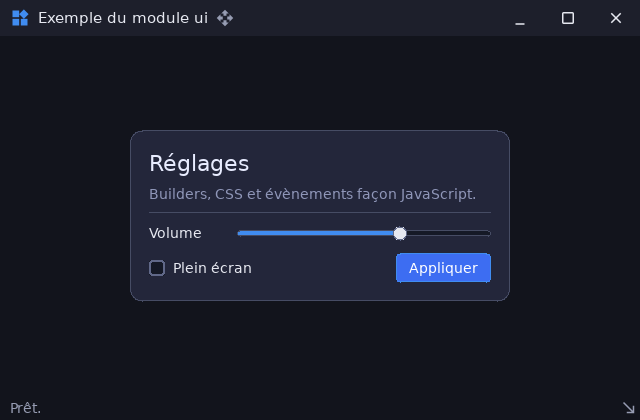

# ui — interface utilisateur déclarative sur l'ECS

`libs/infrastructure/ui` · couche **infrastructure** · `libui.a` · espace de noms `ui::`

## Présentation

`ui` est le module d'interface graphique du dépôt. Toutes les applications
l'utilisent : exemples, émulateur, sandbox, voxelia, profiler.

- **Sur l'ECS** : chaque widget est une entité, ou un petit arbre d'entités,
  d'un `ecs::ArchetypeRegistry`. Il n'existe pas de composant « Bouton ». Un
  bouton est un `Element` de type `button`, auquel s'ajoutent `TextContent`,
  `Pressable` et `Focusable`. Chaque brique est une structure de valeurs
  (`components.hpp`).
- **Builders fluents** façon Flutter : on décrit l'arbre (`ui::Column()`,
  `ui::Button("OK")`…), puis `Mount` le matérialise. `ui::Widget` est une
  poignée (monde + entité) pour le modifier ensuite.
- **CSS** : feuilles globales ou propres à un widget, `@import`,
  `@font-face`, variables `--nom` et `var()`.
  - Sélecteurs : type, `*`, `#id`, `.classe`, `this`, `:root`.
  - Pseudo-classes d'état et de structure.
  - Combinateurs descendant et enfant, spécificité, héritage.
  - **Tout ce que le CSS règle se règle aussi au builder**
    (`style_setters.hpp`).
- **Évènements façon JavaScript** : `OnBind`, `OffBind`, `HasBind`,
  `GetBind` et `GetBinds`.
  - Ils couvrent tous les périphériques de SDL3 et des gestes : clic, double
    clic, N clics, appui long, répétition.
  - Les évènements d'entrée remontent vers les ancêtres (bouillonnement),
    jusqu'à `StopPropagation()`.
- **Mise en page** : flexbox, grille, pile, positionnement absolu, défilement
  et longueurs `fr`.
- **Rendu 2D** par `sdl3::Renderer` (pilote « gpu »). Les **vues 3D**
  (`Viewport3D`) et les **effets de shader** (`ShaderEffect`) passent par
  [`render3d`](libs_infrastructure_render3d.md).
- **Plusieurs fenêtres** (`WindowManager`) : une interface et un monde ECS par
  fenêtre, et un seul périphérique GPU partagé.
- **Fenêtres sans décoration système** : `WindowFrame` fournit la barre de
  titre, les boutons, la barre d'état, la poignée et le hit-test.

## Architecture interne

| En-tête | Rôle |
|---|---|
| `ui.hpp` | En-tête parapluie et façade `ui::Ui` |
| `components.hpp`, `types.hpp` | Briques ECS (`Element`, `TextContent`, `Pressable`, `Range`, `Selection`, `AppSurface`…) et types valeur (longueurs CSS, alignements, ombres) |
| `builder.hpp`, `widgets.hpp`, `style_setters.hpp`, `event_methods.hpp` | `WidgetBuilder` et fabriques de widgets ; méthodes de style et d'évènement partagées par les builders et `Widget` |
| `widget.hpp` | `Widget` (poignée) : `Find`, `Append`, `Destroy`, `Text`, `Value`, `Checked`, `Emit`… |
| `css.hpp`, `style.hpp`, `theme.hpp` | Analyse CSS (syntaxe lue par `dataio::CssDocument`), propriétés et cascade, thèmes (`StructureCss`, `ThemeCss(palette)`) |
| `events.hpp` | `Trigger`, `WidgetEvent`, `EventCallback`, liaisons |
| `context.hpp` | `Context` (ressource du monde : feuilles, polices, textures, peintre, survol, focus, popups, `FrameTimings`) |
| `systems.hpp` | Systèmes `ui_input`, `ui_animation`, `ui_style`, `ui_layout`, `ui_render`, et `Install(schedule)` |
| `painter.hpp`, `text.hpp`, `fonts.hpp`, `geometry.hpp` | Dessin 2D, mesure et découpe du texte, familles de polices, géométrie partagée par la saisie et le rendu |
| `glyphs.hpp`, `icons.hpp` | Icônes typées `MaterialIcons` et `CupertinoIcons` |
| `window_manager.hpp` | `WindowSpec`, `WindowContext`, `WindowManager`, `GlobalShortcut` |
| `window_frame.hpp`, `canvas_window_frame.hpp`, `chrome.hpp` | Encadrement de fenêtre : `WindowFrame`, `CanvasWindowFrame` (3D dans la swapchain), `TitleBar`, `StatusBar`, `WindowChrome` |
| `viewport3d.hpp`, `shader_effect.hpp` | Vue 3D intégrée ; post-traitement GPU d'un sous-arbre |
| `plot.hpp` | Graphiques façon ImPlot : courbes, nuages, barres, histogrammes, aires, camemberts, heatmaps, chandeliers ; zoom et déplacement |
| `nodegraph.hpp` | Éditeur de graphes de nœuds (style Blueprint) sérialisable |
| `scene.hpp` | `SceneManager` : écrans construits au premier affichage, puis cachés sans être détruits |

Dépendances : `core`, `diagnostics`, `ecs`, `math`, `sdl3`, `dataio` (CSS)
et `render3d`.

## API publique

### `ui::Ui` (façade d'une interface)

| Membre | Rôle |
|---|---|
| `Ui(world, window, renderer, Theme)` | Interface d'une fenêtre. Charge les polices par défaut (DejaVu, icônes) si SDL_ttf est initialisé |
| `Ui(world, renderer, viewport)`, `Ui(world, viewport)` | Rendu sur surface ; sans rendu (tests) |
| `Mount(builder [, parent])`, `Root()`, `Find(sélecteur)`, `FindAll` | Arbre |
| `LoadStyleSheet(chemin)`, `AddStyleSheet(css)`, `RemoveStyleSheet`, `ClearStyleSheets`, `SetTheme(Theme | Palette)`, `CurrentPalette()` | Styles |
| `LoadFont(famille, chemin, poids, style)`, `RegisterFont`, `LoadDefaultFonts`, `GetFonts`, `GetTextures` | Ressources |
| `Initialize(render3d::Canvas&)` | Périphérique GPU des `Viewport3D` et `ShaderEffect` |
| `bool HandleEvent(ev)` | Vrai si l'interface a consommé l'évènement, qui est alors marqué (`IsConsumed`) |
| `Update(dt)`, `Layout()`, `Render()` | Animations et minuteries ; styles et mise en page ; dessin |
| `Install(schedule)` | Ajoute les systèmes à un `ecs::Schedule`, au lieu d'appeler `Update` et `Render` |
| `SetViewport`, `SetContentScale` (HiDPI) | Taille et échelle |
| `PointerOverUi`, `Hovered`, `Focused`, `ClearFocus`, `HasOpenModal`, `CloseAllPopups`, `SetKeyPassThrough` | Saisie |
| `Timings()` | Mesures de l'image (styles résolus, passes de mise en page…) |

### Widgets (`widgets.hpp`)

| Catégorie | Fabriques |
|---|---|
| Conteneurs | `Box`, `Panel`, `Column`, `Row`, `Stack`, `Grid`, `Wrap`, `ScrollView`, `Splitter`, `TabView`, `Expander`, `Spacer`, `Separator` |
| Texte | `Label`, `Heading`, `Text`, `Badge`, `Icon`, `Image`, `LogView` |
| Boutons | `Button`, `IconButton`, `Checkbox`, `Radio`, `Switch`, `Selectable` |
| Saisie | `Input`, `Password`, `TextArea`, `CodeEditor`, `NumberInput`, `DragValue`, `Slider`, `Knob`, `Combo`, `ColorPicker`, `ColorSwatch`, `DatePicker`, `Calendar` |
| Listes | `ListBox`, `SelectionList`, `Table`, `TreeNode` |
| Menus | `MenuBar`, `Menu`, `SubMenu`, `MenuItem`, `MenuSeparator`, `ContextMenu`, `Popup`, `Modal` |
| Divers | `Progress`, `Spinner`, `ScrollBar`, `Canvas`, `ShapeBox` |

### Méthodes communes des builders (extrait)

| Domaine | Méthodes |
|---|---|
| Identité | `Id`, `Class`, `Classes`, `Ref(widget)`, `Import(css)`, `Css` |
| Taille | `Width`, `Height`, `MinWidth`, `MaxWidth`, `Fill`, `Grow`, `GrowWidth`, `GrowHeight`, `Shrink` |
| Disposition | `Horizontal`, `Vertical`, `Gap`, `Padding`, `Margin`, `AlignItems`, `JustifyContent`, `Absolute`, `Anchor`, `Left`/`Top`…, `ZIndex`, `GridColumns` |
| Apparence | `Background`, `BackgroundColor`, `Border`, `BorderRadius`, `BoxShadow`, `Opacity`, `Gradient`, `Glass`, `Glow` |
| Texte | `Color`, `FontSize`, `FontFamily`, `Bold`, `Italic`, `TextAlign`, `TextWrap`, `Ellipsis`, `Marquee` |
| Comportement | `Scrollable`, `Clip`, `Focusable`, `Disabled`, `Hidden`, `Tooltip`, `Cursor`, `DragSource`, `DropTarget`, `Reorderable`, `AppSurface`, `PointerThrough` |
| Styles d'état | `HoverStyle`, `ActiveStyle`, `FocusStyle`, `CheckedStyle`, `SelectedStyle`, `DisabledStyle` |
| Évènements | `OnBind`, `OffBind`, `OnClick`, `OnDoubleClick`, `OnRightClick`, `OnChange`, `OnToggle`, `OnSelect`, `OnSubmit`, `OnTextChange`, `OnKey`, `OnWheel`, `OnScroll`, `OnHover`, `OnFocus`, `OnContextMenu`, `OnDrop`, `OnFileDrop`, `OnDragStart`, `OnReorder`, `OnOpen`, `OnClose`, `OnCustom` |
| Arbre | `Child`, `Children` |

### `Trigger` et `WidgetEvent`

- **`Trigger {source/code, geste, paramètre}`**. Exemples :
  - `{sdl3::MouseButton::Left, sdl3::ButtonEvent::MultiClicks, 4}` ;
  - `{sdl3::GamepadButton::EAST, sdl3::ButtonEvent::Clic, 0}`.
- **Gestes** (`sdl3::ButtonEvent`) : `Press`, `Release`, `Clic`,
  `DoubleClic`, `MultiClicks`, `Hold` et `Repeat`.
- **`WidgetEvent`** :
  - `target` et `currentTarget` ;
  - `trigger` et `raw` (l'évènement SDL) ;
  - `pointer`, `delta`, `wheel`, `clicks`, `mods` ;
  - `value`, `index`, `checked`…

### Cascade CSS et pièges connus

Un clic sur le libellé d'un bouton atteint le bouton. Règles de la cascade :

- **Règles privées** : une règle dont le dernier sélecteur est `#id` ou
  `this` ne s'applique qu'au widget visé et ne se transmet pas aux enfants.
- **Règles partagées** : les règles de type ou de classe transmettent leurs
  propriétés héritables.
- **Règles ignorées** : une règle invalide est ignorée et signalée dans
  `Warnings()`. Les règles-@ inconnues (`@media`…) sont ignorées sans
  erreur.

Pièges relevés pendant la refonte :

- **`Clip()` et `Scrollable()`** : `Clip()` vaut `overflow: hidden` et
  **remplace** un `Scrollable()` précédent. Une boîte qui défile rogne déjà
  son contenu.
- **Menus contextuels** : le menu contextuel remonte comme `contextmenu` en
  JavaScript. Une ligne qui a son propre menu, dans une liste qui en a un
  aussi, doit appeler `StopPropagation()`.
- **État sélectionné** : `:selected` vient de la `Selection` de l'ancêtre le
  plus proche (`SelectItem{index}`), pas d'un booléen par ligne.
- **Pointeur et vue 3D** : un widget « plein » (fond, image, cible de dépôt)
  **consomme** le pointeur. Pour qu'une vue 3D reçoive la souris (caméra,
  gizmo), marquez-la `.AppSurface()`.

### Plusieurs fenêtres (`WindowManager`)

**Création**

- `WindowSpec` décrit la fenêtre :
  - `title`, `width`, `height`, `position` ou `display`, `flags` ;
  - `renderDriver` (`"gpu"`), `vsync`, `theme` ;
  - `styleSheets`, `css` ;
  - `role`, `primary`, `followDisplayScale`, `headless`.
- `Create(spec)` et `CreateOnDisplay(i, spec)` rendent un `WindowContext*`,
  qui porte sa fenêtre, son renderer, **son** monde ECS et **son** `ui::Ui`.

**Boucle**

- `Dispatch(ev)` route l'évènement vers la bonne fenêtre et gère les
  raccourcis globaux (`AddGlobalShortcut`).
- `Update(dt)`, puis `Render(clear)`, ou `Draw` suivi de `Present`.

**Fermeture**

- `HandleCloseRequests()` ferme les fenêtres secondaires.
- Fermer la principale ou la dernière met `QuitRequested()` à vrai.

**GPU**

- Le gestionnaire possède **un** `SDL_GPUDevice` partagé par toutes les
  fenêtres.
- Un `render3d::Canvas` créé depuis un renderer emprunte ce périphérique. Il
  doit donc être détruit **avant** le gestionnaire.

**Captures** : `RequestCapture(id, chemin)` et `RequestDesktopCapture(chemin)`.

### Encadrement de fenêtre

1. Créer la fenêtre avec `ui::WindowFrame::WINDOW_FLAGS` (sans bordure,
   redimensionnable).
2. `frame.Build(gui, window, {.title, .appIcon, .status})`.
3. Ajouter le contenu dans `frame.Content()`.
4. Appeler `frame.Update()` à chaque image et tester `frame.CloseRequested()`.

Variantes :

- `CanvasWindowFrame` pour une scène `render3d` dessinée directement dans la
  swapchain (barres copiées par `Canvas::SetOverlay`) ;
- `TitleBar`, `StatusBar` et `WindowChrome` pour une coquille sur mesure.

## Exemple

```cpp
#include <cstdio>
#include <sdl3/sdl3.hpp>
#include <ui/ui.hpp>

static const char *CSS = R"(
.card { background-color: #23263a; border-radius: 12px; padding: 18px; gap: 10px; }
#title { font-size: 22px; color: #e8ecff; }
.hint { color: #8f96b8; }
Button.primary { background-color: #3d6df2; }
Button.primary:hover { background-color: #5a84ff; }
)";

int main(int argc, char **argv) {
	const bool shot = argc > 1; // « ./ui capture » : une image puis capture PNG
	auto sdl = sdl3::SdlContext::Create(sdl3::init_flags::VIDEO | sdl3::init_flags::EVENTS);
	auto ttf = sdl3::TtfContext::Create();
	auto win = sdl3::Window::Create("ui", 640, 420, ui::WindowFrame::WINDOW_FLAGS);
	if (!sdl || !ttf || !win)
		return 1;
	auto ren = sdl3::Renderer::Create(win.Value());
	if (!ren)
		return 1;

	ecs::ArchetypeRegistry world; // un monde ECS par interface
	ui::Ui gui(world, win.Value(), ren.Value());
	gui.AddStyleSheet(CSS);

	ui::WindowFrame frame; // barre de titre, zone de contenu, barre d'état
	frame.Build(gui, win.Value(), {.title = "Exemple du module ui", .appIcon = Some(ui::MaterialIcons::WIDGETS), .status = "Prêt."});

	int clicks = 0;
	frame.Content().Append(ui::Panel().Class("card").Absolute().Anchor(ui::Anchor::Center).Width(380.f).Children({
		ui::Label("Réglages").Id("title"),
		ui::Label("Builders, CSS et évènements façon JavaScript.").Class("hint"),
		ui::Separator(),
		ui::Row().Gap(8.f).Children({
			ui::Label("Volume").Width(80.f),
			ui::Slider(0.f, 100.f, 65.f, 1.f).Id("volume").Grow(),
		}),
		ui::Row().Gap(8.f).Children({
			ui::Checkbox("Plein écran", false),
			ui::Spacer(),
			ui::Button("Appliquer").Class("primary").OnClick([&] { frame.SetStatus("Appliqué (" + String::From(++clicks) + ")"); }),
		}),
	}));

	// Liaison façon JavaScript : double clic gauche OU touche Entrée sur le titre
	if (Option<ui::Widget> title = gui.Find("#title"))
		title->OnBind({sdl3::MouseButton::Left, sdl3::ButtonEvent::DoubleClic, 0}, [&](ui::WidgetEvent) { frame.SetStatus("Titre !"); });

	bool running = true;
	for (int f = 0; running; ++f) {
		while (auto ev = sdl3::PollEvent()) {
			if (ev->IsQuit())
				running = false;
			gui.HandleEvent(ev.Value()); // vrai si l'interface l'a consommé
		}
		gui.Update(1.f / 60.f);
		frame.Update();
		if (frame.CloseRequested())
			running = false;
		ren.Value().SetDrawColor(gui.CurrentPalette().appBg);
		ren.Value().Clear();
		gui.Render();
		if (shot && f == 2) {
			if (auto px = ren.Value().ReadPixels())
				(void)sdl3::ImgSavePng(px.Value(), "ui.png");
			running = false;
		}
		ren.Value().Present();
	}
	return 0;
}
```



## Intégration

```toml
[dependencies]
modules = ["ui"]   # tire ecs, render3d, dataio, sdl3…
```

1. Initialisez SDL (`VIDEO | EVENTS`) et **SDL_ttf** (`sdl3::TtfContext`)
   avant de construire `ui::Ui` : les polices par défaut ne se chargent que
   si SDL_ttf est prêt.
2. Utilisez un `ecs::ArchetypeRegistry` dédié à chaque interface.
3. Vues 3D :
   - appelez `gui.Initialize(canvas)` ;
   - l'`Object3D` affiché doit vivre plus longtemps que le widget.

Les polices et icônes sont lues dans `assets/fonts` (DejaVuSans,
MaterialIcons, CupertinoIcons). Lancez donc les applications **depuis la
racine du dépôt**.

## Tests

```sh
cpp-maker test -m ui
```

Les tests utilisent un harnais sans fenêtre (`tests/harness.hpp`). Ils
couvrent la cascade, le CSS, les évènements, les extensions, la mise en page,
les widgets et le multi-fenêtre.
